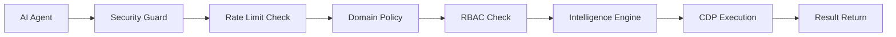
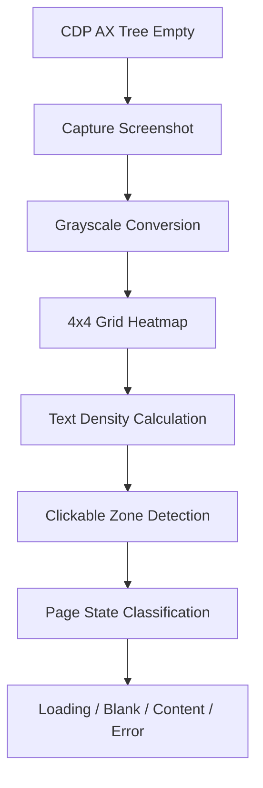
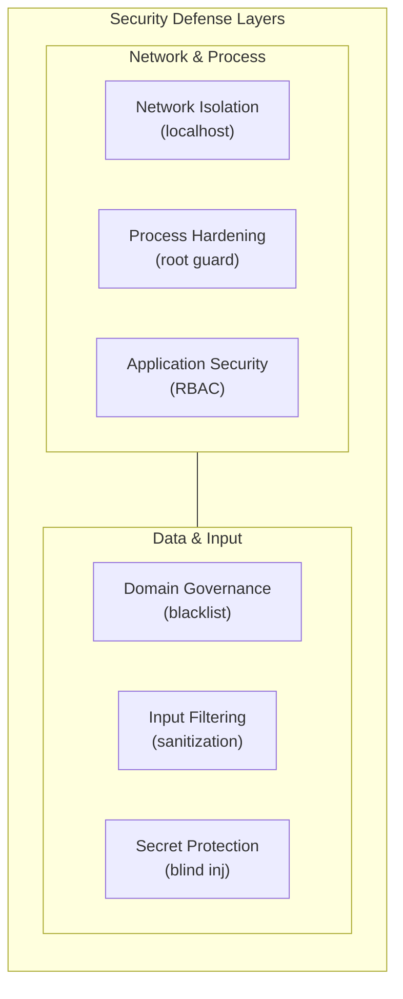

# Weavetab Architecture

> **Version:** 2.5.0 (Beta) | **Last Updated:** July 2026

---

## System Overview

Weavetab is an MCP (Model Context Protocol) server engineered for AI-driven browser automation. Unlike Playwright or Puppeteer, it communicates directly with Chromium via the Chrome DevTools Protocol (CDP) WebSocket — there is no WebDriver process, no browser binary download, and no heavy abstraction layer. This yields sub-10ms tool execution latency.

The system is composed of five architectural layers:


---

## Tool Execution Pipeline

Every tool invocation follows a deterministic pipeline:



### Pipeline Stages

1. **Security Guard** — Initial rate limit check
2. **Domain Policy** — Check domain against blacklist/policy engine
3. **RBAC Check** — Verify role-based tool permissions
4. **Agent State** — Report tool call, transition to 'weaving' state
5. **Intelligence Engine** — Load domain profile, cached strategies, hints
6. **CDP Execution** — Execute tool via Chrome DevTools Protocol
7. **State Update** — Report success/failure, update domain profile
8. **Return Result** — Return structured result to AI agent

### Additional Checks

- **User stop requests** via `window.__wt_stop_requested` in overlay HUD
- **Chat queue** messages from user (`window.__wt_chat_queue`)
- **Config live-reload** via `fs.watch` on `config.json`

---

## Intelligence Engine

### Session Memory

The session memory system maintains persistent per-domain profiles on disk at `~/.Weavetab/memory/`. Each profile tracks:

```typescript
interface DomainProfile {
  strategies: string[];       // Interaction strategies that succeeded
  knownInputs: Array<{        // Previously discovered input selectors
    label: string;
    selector: string;
  }>;
  shadowDom: boolean;         // Whether the domain uses Shadow DOM
  framework?: string;         // Auto-detected framework (react/vue/angular/etc.)
  updatedAt: string;          // ISO timestamp of last update
  visitCount: number;         // Total visits accumulated
}
```

**Automatic Framework Detection** runs via `Runtime.evaluate` probes for 8 frameworks:

```
Page Load → Check React → Check Vue → Check Angular → Check Lit 
→ Check Svelte → Check Next/Nuxt/Gatsby → Cache Result
```

### Semantic Delta Engine

The delta engine (`src/state/delta.ts`) implements a per-tab snapshot diffing system:

| Aspect | Implementation |
|--------|---------------|
| **Storage** | `Map<targetId, Map<refId, RefEntry>>` in memory |
| **Fingerprint** | `role:normalizedLabel:parentRole:depth` for stable identity |
| **Diff Output** | `{ added: [], removed: [], changed: [], stable_count: N }` |
| **Rich Delta** | Adds property-level diffs (label, value, disabled, href, className changes) |
| **Iframe Tracking** | Per-frame element counts tracked separately |
| **Actionable Recommendations** | Changed interactive elements flagged with suggested action |

**Delta Flow:**


### Semantic DOM Pruner

The pruner (`src/cdp/pruner.ts`) performs **one-shot compression of a single DOM snapshot before it is returned to the agent**. This is fundamentally distinct from the Delta Engine:

| Dimension | Delta Engine | Semantic DOM Pruner |
|-----------|-------------|---------------------|
| **What it operates on** | Two snapshots across time | One snapshot, right now |
| **When it runs** | After the current map is built | Before the current map is returned |
| **Output** | Added / removed / changed elements | Compressed element list |
| **Activation** | `browser_map({ delta: true })` | `browser_map({ prune: true })` |
| **Combine?** | Yes — delta of a pruned snapshot gives maximum token efficiency |

**Implementation Details:**

| Aspect | Detail |
|--------|--------|
| **Execution** | 1 `Runtime.evaluate` call (2 if page exceeds perf gate) |
| **Performance target** | p95 < 5ms on Jira/AWS-scale DOMs |
| **Pass 1 — controlsMap** | Collects all `aria-controls`, `aria-owns`, `data-target` values |
| **Pass 2 — subtree annotation** | Bottom-up walk, computes `hasInteractiveDescendant` per node |
| **Pass 3 — prune decision** | Keep if: visible OR has interactive descendant OR in controlsMap |
| **SVG handling** | Resolves label from: svg `aria-label` → svg `<title>` → ancestor `aria-label` |
| **Secret safety** | `data-wt-secret` guard fires on the attribute, not the id |

### Loop Detection and Trail System

The trail module (`src/intelligence/trail.ts`) maintains a rolling window of the last 50 tool actions. It implements strike-based loop detection:

```
Loop Detection Algorithm
─────────────────────────
  Input: tool name, element ref
  Process: Scan trail backwards, count consecutive failures
           matching same tool + ref

  strikes < 5   → severity: "none"
  strikes 5-9   → severity: "warning"     (HUD notification)
  strikes >= 10 → severity: "critical"    (state → "stuck", recovery triggered)
```

**Auto-reset Triggers:**
- Navigation events
- Tab switches
- Burst mode start
- Manual override via `browser_reset_loop_counter`

### Knowledge Hints (Rule 16)

Domain-specific knowledge is stored in `~/.Weavetab/knowledge/[domain].md`. When a tool discovers a site-specific quirk (e.g., "this login form requires clicking the label, not the input"), it appends a timestamped note. On subsequent visits, the hint is injected as a system prompt token (max 20 tokens).

**Hint Format:**

```markdown
# example.com Knowledge Base

## 2026-07-06T14:30:00Z
- Login form requires clicking the label, not the input element
- Search bar uses Shadow DOM, requires `ax_tree: true`

## 2026-07-05T09:15:00Z
- Navigation triggers SPA route change, wait 200ms for DOM stability
```

### Vision Fallback System

When the CDP Accessibility Tree returns zero elements, Weavetab falls back to local pixel analysis using the `sharp` library:



This runs entirely locally with no external API calls or ML dependencies.

---

## Sensor Systems

### Network Telemetry

The network sensor (`src/sensors/network.ts`) intercepts CDP Network events to track:

- Request/response timing
- Resource types (XHR, fetch, document, script, stylesheet)
- HTTP status codes
- Response sizes
- CORS errors

**Usage:** Enables `browser_network_intercept` for API mocking and tracking.

### DOM Mutation Watcher

The mutation sensor (`src/sensors/mutations.ts`) uses CDP DOM mutation events to detect:

- Added/removed nodes
- Attribute changes
- Text content changes
- Shadow DOM updates

**Usage:** Powers the delta engine and automatic cache invalidation.

### Human Pacing Engine

The pacing sensor (`src/sensors/pacing.ts`) tracks timing patterns to:

- Detect abnormal speed (too fast = bot, too slow = stuck)
- Adjust Ghost Cursor timing for natural movement
- Modulate typing cadence based on field complexity

**Usage:** Enhances input realism and prevents detection.

### Agent State Machine

The state machine (`src/state/agent.ts`) manages agent lifecycle:

| State | Trigger | Behavior |
|-------|---------|----------|
| **idle** | No recent tool calls | HUD shows idle status |
| **weaving** | Tool execution in progress | HUD shows active tool |
| **stuck** | 10+ loop strikes | Auto-recovery triggered, HUD shows warning |

### Thought HUD System

The HUD (`src/sensors/thoughts.ts`) provides real-time visual feedback:

- Current tool being executed
- Execution time and token estimates
- Loop warnings
- User chat messages
- Mission progress

### Audit & Telemetry

The audit system (`src/audit/logger.ts`) maintains structured logs:

- **Mission logs** (`~/.Weavetab/logs/audit.log`) — Human-readable activity log
- **Structured logs** (`~/.Weavabab/logs/audit.jsonl`) — Machine-readable JSONL format
- **Telemetry** (optional) — Event broadcasting for analytics

---

## CDP Bridge

### DOM Walker

The walker (`src/cdp/walker.ts`) performs DOM enumeration via CDP:

- **Accessibility Tree** — Primary source for element discovery
- **DOM traversal** — Fallback for complex Shadow DOM scenarios
- **Element resolution** — Maps backend node IDs to volatile `w:NN` refs that invalidate on mutation
- **Label extraction** — Prioritizes aria-label, placeholder, text content

### Ghost Cursor Engine

The ghost cursor (`src/overlay/ghost.ts`) implements human-like mouse movement:

- **Bézier curves** — Natural path generation with control points
- **Acceleration** — Variable speed based on distance
- **Jitter** — Subtle randomization for human variation
- **Hold delay** — Configurable button hold duration

### Keystroke Engine

The typing engine (`src/tools/type.ts`) simulates realistic keyboard input:

- **Per-character jitter** — Randomized typing speed (50-150ms per char)
- **Burst patterns** — Natural typing cadence (fast bursts, natural pauses)
- **Stuck detection** — Real-time DOM diffing to detect failed input
- **Auto-clear** — Atomic field clearing before typing

### Semantic Pruner

The pruner (`src/cdp/pruner.ts`) compresses DOM snapshots:

- **Hidden element removal** — Drops non-interactive hidden elements
- **SVG collapsing** — Replaces SVG icons with `[SVG Icon: label]` tokens
- **Controls preservation** — Keeps elements referenced by `aria-controls`
- **Secret safety** — Preserves `data-wt-secret` elements

### Shadow DOM Injector

The injector (`src/overlay/injector.ts`) manages UI overlay:

- **Voice UI** — Speech-to-text input for 2FA and sensitive data
- **DevMode HUD** — Real-time debugging information
- **Chat interface** — User-to-agent communication
- **Plan dashboard** — Mission progress visualization

### Tab & Window Manager

The session registry (`src/state/session.ts`) manages browser sessions:

- **Session pooling** — Reuses CDP connections across tabs
- **Target ID mapping** — Maps MCP client IDs to CDP targets
- **Lifecycle management** — Handles tab creation, switching, closure
- **Crash recovery** — Detects and heals crashed tabs

### Browser Launcher

The launcher (`src/cdp/connector.ts`) manages browser startup:

- **Lock system** — Two-factor validation (PID + TCP port)
- **Extension loading** — Injects Weavetab extension on startup
- **Remote debugging** — Connects to existing Chrome instances
- **Headless mode** — Supports both headed and headless execution

---

## Security Architecture

### Layered Security Model



### Security Mechanisms

| Mechanism | Implementation | Threat Mitigated |
|-----------|----------------|------------------|
| **Domain Blacklist** | Hardcoded + custom JSON config | High-risk domain access |
| **Domain Policy Engine** | Per-domain allow/read-only/deny/audit modes | Unauthorized domain interactions |
| **RBAC** | 4 roles with tool permission matrix | Privilege escalation |
| **Rate Limiting** | Mutex-based actions/min enforcement | Runaway agent behavior |
| **Root Guard** | `assertNotRoot()` at startup | Privileged execution |
| **Storage Blocker** | Optional localStorage/sessionStorage nullification | Tracking/fingerprinting |
| **Input Filter** | Suspicious label stripping | Prompt injection |
| **Blind Injection** | Domain-scoped secret injection with masking | Credential leakage |
| **Shadow DOM Isolation** | UI in isolated Shadow DOM | Host page tampering |
| **Localhost Binding** | CDP WS bound to 127.0.0.1 | Remote exploitation |
| **Two-Factor Lock** | PID + TCP port validation | Stale lock false-positives |

---

## Performance Characteristics

### Latency Breakdown

| Operation | Mean Latency | P95 Latency | P99 Latency |
|-----------|--------------|-------------|-------------|
| **Tool security checks** | 0.5ms | 1ms | 2ms |
| **CDP round-trip** | 2-5ms | 8ms | 15ms |
| **DOM walk (first)** | 8-15ms | 25ms | 40ms |
| **DOM walk (cached)** | 1-3ms | 5ms | 10ms |
| **Delta computation** | 1-2ms | 4ms | 8ms |
| **Ghost cursor execution** | 3-8ms | 12ms | 20ms |
| **Total end-to-end** | 3-8ms | 15ms | 25ms |

### Memory Footprint

| Component | Memory Usage |
|-----------|--------------|
| **Base server** | ~50MB |
| **Per-session cache** | ~10-20MB |
| **Extension** | ~5MB |
| **Total (typical)** | ~65-75MB |

### Disk Usage

| Component | Disk Usage |
|-----------|------------|
| **Server code** | ~5MB |
| **Extension** | ~2MB |
| **Session memory** | ~1-5MB (per domain) |
| **Knowledge hints** | ~100KB (per domain) |
| **Audit logs** | ~1-10MB (per mission) |

---

## Extensibility Points

### Plugin System

Weavetab supports dynamic plugin loading for any package containing a `weavetab.json` manifest (and official `@weavetab/plugin-*` packages):

```typescript
interface WeavetabPlugin {
  name: string;
  version: string;
  tools: Array<{
    name: string;
    description: string;
    handler: (session: CDP.Client, config: Config) => Promise<any>;
  }>;
}
```

### Skills Ecosystem

The `@weavetab/skills` package provides pre-built workflow patterns:

- **Multi-step form automation** — Complex form filling with validation
- **E-commerce checkout** — Shopping cart navigation and payment
- **Data extraction pipelines** — Structured scraping and export
- **CMS workflows** — WordPress, Drupal, and CMS-specific patterns
- **API testing** — Endpoint testing and response verification

### Custom Tool Registration

Developers can add custom tools by:

1. Implementing the tool handler function
2. Registering via `server.tool()` in `src/server.ts`
3. Adding Zod schema validation
4. Implementing security checks via `withSecurity()`
5. Adding audit logging via `logAction()`

---

## Monitoring and Observability

### Built-in Metrics

- **Tool execution time** — Per-tool timing breakdown
- **Cache hit rates** — DOM map and delta cache efficiency
- **Loop detection events** — Strike count and severity
- **Domain profile hits** — Session memory utilization
- **Network request counts** — Per-domain request tracking

### Audit Trail

Every tool invocation generates structured audit logs:

```json
{
  "timestamp": "2026-07-06T14:30:00Z",
  "sessionId": "default",
  "tool": "browser_click",
  "duration": 8,
  "result": "success",
  "pageUrl": "https://example.com",
  "tabTitle": "Example Domain"
}
```

### DevMode HUD

When `devMode: true` is enabled, the HUD displays:

- Current tool execution
- Real-time timing metrics
- Token usage estimates
- Loop detection warnings
- User chat messages

---

## Conclusion

Weavetab's architecture is designed for **autonomous AI agents** requiring:

- **Sub-10ms latency** for real-time interaction
- **5-10x token efficiency** for cost-effective operation
- **Enterprise-grade security** for production deployment
- **Self-learning capabilities** for improved success rates
- **Human-like behavior** for authorized automation
- **Extensibility** for custom workflows

The five-layer architecture (Transport → Security → Intelligence → Sensors → CDP) provides a robust foundation for AI-driven browser automation at scale.
- Loop detection warnings
- User chat messages

---

## Conclusion

Weavetab's architecture is designed for **autonomous AI agents** requiring:

- **Sub-10ms latency** for real-time interaction
- **5-10x token efficiency** for cost-effective operation
- **Enterprise-grade security** for production deployment
- **Self-learning capabilities** for improved success rates
- **Human-like behavior** for authorized automation
- **Extensibility** for custom workflows

The five-layer architecture (Transport → Security → Intelligence → Sensors → CDP) provides a robust foundation for AI-driven browser automation at scale.
- Loop detection warnings
- User chat messages

---

## Conclusion

Weavetab's architecture is designed for **autonomous AI agents** requiring:

- **Sub-10ms latency** for real-time interaction
- **5-10x token efficiency** for cost-effective operation
- **Enterprise-grade security** for production deployment
- **Self-learning capabilities** for improved success rates
- **Human-like behavior** for authorized automation
- **Extensibility** for custom workflows

The five-layer architecture (Transport → Security → Intelligence → Sensors → CDP) provides a robust foundation for AI-driven browser automation at scale.
    description: string;
    handler: (session: CDP.Client, config: Config) => Promise<any>;
  }>;
}
```

### Skills Ecosystem

The `@weavetab/skills` package provides pre-built workflow patterns:

- **Multi-step form automation** — Complex form filling with validation
- **E-commerce checkout** — Shopping cart navigation and payment
- **Data extraction pipelines** — Structured scraping and export
- **CMS workflows** — WordPress, Drupal, and CMS-specific patterns
- **API testing** — Endpoint testing and response verification

### Custom Tool Registration

Developers can add custom tools by:

1. Implementing the tool handler function
2. Registering via `server.tool()` in `src/server.ts`
3. Adding Zod schema validation
4. Implementing security checks via `withSecurity()`
5. Adding audit logging via `logAction()`

---

## Monitoring and Observability

### Built-in Metrics

- **Tool execution time** — Per-tool timing breakdown
- **Cache hit rates** — DOM map and delta cache efficiency
- **Loop detection events** — Strike count and severity
- **Domain profile hits** — Session memory utilization
- **Network request counts** — Per-domain request tracking

### Audit Trail

Every tool invocation generates structured audit logs:

```json
{
  "timestamp": "2026-07-06T14:30:00Z",
  "sessionId": "default",
  "tool": "browser_click",
  "duration": 8,
  "result": "success",
  "pageUrl": "https://example.com",
  "tabTitle": "Example Domain"
}
```

### DevMode HUD

When `devMode: true` is enabled, the HUD displays:

- Current tool execution
- Real-time timing metrics
- Token usage estimates
- Loop detection warnings
- User chat messages

---

## Conclusion

Weavetab's architecture is designed for **autonomous AI agents** requiring:

- **Sub-10ms latency** for real-time interaction
- **5-10x token efficiency** for cost-effective operation
- **Enterprise-grade security** for production deployment
- **Self-learning capabilities** for improved success rates
- **Human-like behavior** for authorized automation
- **Extensibility** for custom workflows

The five-layer architecture (Transport → Security → Intelligence → Sensors → CDP) provides a robust foundation for AI-driven browser automation at scale.
