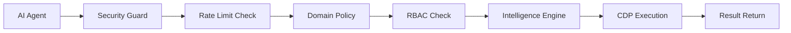
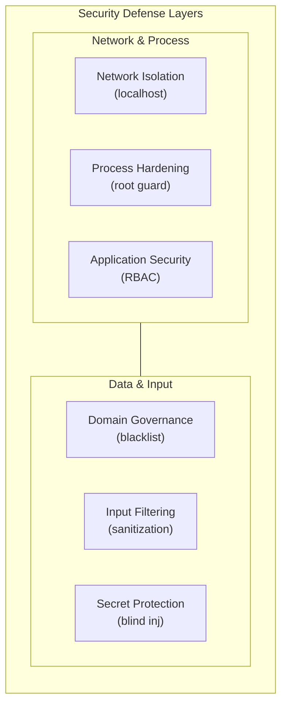

# Weavetab Architecture

> **Version:** 2.6.4 | **Last Updated:** October 2026

---

## System Overview

Weavetab is an MCP (Model Context Protocol) server engineered for AI-driven browser and desktop automation. Unlike Playwright or Puppeteer, it communicates directly with Chromium via the Chrome DevTools Protocol (CDP) WebSocket — there is no WebDriver process, no browser binary download, and no intermediate wrapper layer.

The system is composed of five architectural layers:

---

## Tool Execution Pipeline

Every tool invocation follows a deterministic pipeline:



### Pipeline Stages

1. **Security Guard** — Initial rate limit check
2. **Domain Policy** — Check domain against blacklist/policy engine
3. **RBAC Check** — Verify role-based tool permissions
4. **Agent State** — Report tool call, transition to 'weaving' state
5. **Intelligence Engine** — Load domain profile, cached strategies, hints
6. **CDP Execution** — Execute tool via Chrome DevTools Protocol
7. **State Update** — Report success/failure, update domain profile
8. **Return Result** — Return structured result to AI agent

### Additional Checks

- **Per-tool timeout budgets** with `.unref()` timers inside `withSecurity()`
- **Hook pipeline** (`beforeToolCall` / `afterToolCall`) dispatched after RBAC and domain checks
- **Config live-reload** via lazy `startConfigWatcher()` on `config.json` with self-write suppression

---

## Intelligence Engine

### Session Memory

The session memory system maintains persistent per-domain profiles on disk at `~/.weavetab-system/memory/` with path-traversal containment and atomic temp-file + `rename` writes (capped at 50 memories and 50 failed selectors per domain). Each profile tracks:

```typescript
interface DomainProfile {
  strategies: string[];       // Interaction strategies that succeeded
  knownInputs: Array<{        // Previously discovered input selectors
    label: string;
    selector: string;
  }>;
  shadowDom: boolean;         // Whether the domain uses Shadow DOM
  framework?: string;         // Auto-detected framework (react/vue/angular/etc.)
  updatedAt: string;          // ISO timestamp of last update
  visitCount: number;         // Total visits accumulated
}
```

**Automatic Framework Detection** runs via a single consolidated `Runtime.evaluate` probe across 8 frameworks:

```
Page Load → Single Runtime.evaluate Probe (React / Vue / Angular / Lit / Svelte / Next / Nuxt / Gatsby) → Cache Result
```

### Semantic Delta Engine

The delta engine (`src/state/delta.ts`) implements a per-tab snapshot diffing system with `SessionSecretTracker` redaction on `RefEntry` labels and values:

| Aspect | Implementation |
|--------|---------------|
| **Storage** | `Map<targetId, Map<refId, RefEntry>>` and `propSnapshots` in memory (cleaned on `clearSnapshot`) |
| **Fingerprint** | `role:normalizedLabel:parentRole:depth` for stable identity |
| **Diff Output** | `{ added: [], removed: [], changed: [], stable_count: N }` with `_refs_truncated` propagation |
| **Rich Delta** | Property-level diffs (label, value, disabled, href, className) with secret redaction |
| **Iframe Tracking** | Per-frame element counts tracked separately |
| **Actionable Recommendations** | Changed interactive elements flagged with suggested action |

### Semantic DOM Pruner

The pruner (`src/cdp/pruner.ts`) performs **one-shot compression of a single DOM snapshot across the document and open Shadow roots before it is returned to the agent**, while preserving OmniBroker child frame elements. This is distinct from the Delta Engine:

| Dimension | Delta Engine | Semantic DOM Pruner |
|-----------|-------------|---------------------|
| **What it operates on** | Two snapshots across time | One snapshot, right now |
| **When it runs** | After the current map is built | Before the current map is returned |
| **Output** | Added / removed / changed elements | Compressed element list |
| **Activation** | `browser_map({ delta: true })` | `browser_map({ prune: true })` |
| **Combine?** | Yes — delta of a pruned snapshot gives maximum token efficiency |

**Implementation Details:**

| Aspect | Detail |
|--------|--------|
| **Execution** | 1 `Runtime.evaluate` call (2 if page exceeds perf gate) |
| **Pass 1 — controlsMap** | Collects all `aria-controls`, `aria-owns`, `data-target` values |
| **Pass 2 — subtree annotation** | Bottom-up walk, computes `hasInteractiveDescendant` per node |
| **Pass 3 — prune decision** | Keep if: visible OR has interactive descendant OR in controlsMap |
| **SVG handling** | Resolves label from: svg `aria-label` → svg `<title>` → ancestor `aria-label` |
| **Secret safety** | `data-wt-secret` guard fires on the attribute, not the id |

### Loop Detection and Trail System

The trail module (`src/intelligence/trail.ts`) maintains a rolling window of the last 50 tool actions (`~/.weavetab-system/sessions/context.json`) with `SessionSecretTracker` redaction on `input`, `result`, and `url`, and per-tab scoping (`tabId`) for strike-based and 3-cycle cross-tool loop detection:

```
Loop Detection Algorithm
─────────────────────────
  Input: tool name, element ref, tabId
  Process: Scan per-tab trail backwards, check last 3 consecutive actions
           and 6-action window for 3-cycle cross-tool loops

  strikes < 5   → severity: "none"
  strikes 5-9   → severity: "warning"     (HUD notification)
  strikes >= 10 → severity: "critical"    (state → "stuck", recovery triggered)
```

**Auto-reset Triggers:**
- Navigation events
- Tab switches
- Burst mode start
- Manual override via `browser_map({ force: true })` or `browser_wait({ reset_loop: true })`

### Knowledge Hints

Domain-specific knowledge is stored in `~/.weavetab/knowledge/[domain].md` with path-traversal validation, deduplication, and a 20-line rolling cap. On subsequent visits, the most recent hint line (capped at 150 chars) is injected into session context.

**Hint Format:**

```markdown
# example.com Knowledge Base

## 2026-07-06T14:30:00Z
- Login form requires clicking the label, not the input element
- Search bar uses Shadow DOM, requires `ax_tree: true`

## 2026-07-05T09:15:00Z
- Navigation triggers SPA route change, wait 200ms for DOM stability
```

### Vision Fallback System

When the CDP Accessibility Tree returns zero elements, Weavetab falls back to local pixel analysis via `sharp` (`.removeAlpha().raw().toBuffer({ resolveWithObject: true })` with channel-accurate stride and clickable zones capped at 5) alongside structural DOM heuristics — with zero external API calls.

---

## Sensor Systems

### Network Telemetry

The network sensor (`src/sensors/network.ts`) lazily attaches CDP Network listeners on `start()`, unsubscribes cleanly on `stop()`, and tracks bounded buffers (500 requests, 200 errors, 100 toasts):

- Request/response timing
- Resource types (XHR, fetch, document, script, stylesheet)
- HTTP status codes
- Response sizes
- CORS errors

**Usage:** Enables `browser_network_intercept` for API mocking and tracking.

### DOM Mutation Cache Invalidator

The cache layer (`src/state/cache.ts`) subscribes to CDP DOM events (`documentUpdated`, `childNodeInserted`, `childNodeRemoved`, `attributeModified`, `attributeRemoved`) to synchronously update `lastMutationTime` and clear cached `boxModels` and `domNodes`.

**Usage:** Powers the delta engine and automatic cache invalidation.

### Human Pacing Engine

The pacing sensor (`src/sensors/pacing.ts`) tracks timing patterns to:

- Detect abnormal speed (too fast = bot, too slow = stuck)
- Adjust Ghost Cursor timing for natural movement
- Modulate typing cadence based on field complexity

**Usage:** Enhances input realism and prevents detection.

### Agent State Machine

The state machine (`src/state/agent.ts`) manages agent lifecycle:

| State | Trigger | Behavior |
|-------|---------|----------|
| **idle** | No recent tool calls | HUD shows idle status |
| **weaving** | Tool execution in progress | HUD shows active tool |
| **stuck** | 10+ loop strikes | Auto-recovery triggered, HUD shows warning |

### Thought HUD System

The HUD (`src/sensors/thoughts.ts`) provides real-time visual feedback:

- Current tool being executed
- Execution time and token estimates
- Loop warnings
- User chat messages
- Mission progress

### Audit & Telemetry

The audit system (`src/audit/logger.ts`) maintains structured logs with automatic `SessionSecretTracker` redaction and log retention pruning (keeping the latest 30 `mission_*` files in `~/.weavetab-system/logs/`):

- **Mission logs** (`~/.weavetab-system/logs/mission_<timestamp>.log`) — Human-readable activity log
- **Structured logs** (`~/.weavetab-system/logs/mission_<timestamp>.jsonl`) — Machine-readable JSONL format
- **Telemetry** (opt-in via `telemetry: true`) — Anonymous local UDP event broadcasting and atomic `stats.json` persistence with `0o600` + Windows `icacls` on `telemetry-secret`

---

## CDP Bridge

### DOM Walker

The walker (`src/cdp/walker.ts`) performs DOM enumeration via CDP:

- **Accessibility Tree** — Primary source for element discovery with `depth: 0` DOM root initialization, 10s TTL `axTreeCache`, and 16-chunk `getBoxModel` batching
- **DOM & OmniBroker traversal** — Fallback for complex Shadow DOM and out-of-process iframe (`iframe` / `webview`) scenarios with parent-frame coordinate offsets and secret redaction
- **Element resolution** — $O(N)$ `backendNodeId → nodeId` mapping into volatile `w:NN` refs; cached map reuse when the DOM has not mutated, with a bounded 1500ms load-stability wait on cold walks
- **Label extraction** — Prioritizes aria-label, placeholder, text content with `stripInvisibleChars` and `filterHidden` sanitization

### Ghost Cursor Engine

The ghost cursor (`src/overlay/ghost.ts`) implements human-like mouse movement:

- **Bézier curves** — Natural path generation with control points
- **Acceleration** — Variable speed based on distance
- **Jitter** — Subtle randomization for human variation
- **Hold delay** — Configurable button hold duration

### Keystroke Engine

The typing engine (`src/tools/type.ts`) simulates realistic keyboard input:

- **Per-character jitter** — Randomized typing speed (50-150ms per char)
- **Burst patterns** — Natural typing cadence (fast bursts, natural pauses)
- **Stuck detection** — Real-time DOM diffing to detect failed input
- **Auto-clear** — Atomic field clearing before typing

### Semantic Pruner

The pruner (`src/cdp/pruner.ts`) compresses DOM snapshots:

- **Hidden element removal** — Drops non-interactive hidden elements across document and open Shadow roots
- **SVG collapsing** — Replaces SVG icons with `[SVG Icon: label]` tokens
- **Controls & child-frame preservation** — Keeps elements referenced by `aria-controls` and OmniBroker child frame elements
- **Secret safety** — Preserves `data-wt-secret` elements

### Shadow DOM Injector

The injector (`src/overlay/injector.ts`) manages UI overlay bridges:

- **Sanitized webpage config** — Passes only `{ devMode }` to page context (`buildConfigExpr`), tracked via a `WeakSet` per session and short-circuited in `headless` mode
- **Top-frame MV3 extension HUD & cursor** — Mounts HUD, cursor, and indicator exclusively in the top frame (`window === window.top`) with origin-checked messaging and HTML-escaped anchor badges
- **DevMode HUD & Debug Menu** — Real-time overlays inside the isolated extension HUD iframe (`Alt+Shift+D`)

### Tab & Window Manager

The session registry (`src/state/session.ts`) manages browser sessions:

- **Session pooling** — Reuses CDP connections across tabs and clears stale persisted `contexts.json` on startup
- **Target ID mapping** — Maps MCP client IDs to CDP targets and clears `SessionSecretTracker` state on `unregister()`
- **Lifecycle management** — Handles tab creation, switching, closure, and navigation cache invalidation (`clearSnapshot`, `clearAXTreeCache`, `clearShadowDomCache`, `labelCache.invalidate`)
- **Crash recovery** — Detects and heals crashed tabs

### Browser Launcher

The launcher (`src/cdp/connector.ts`, `src/cdp/bridge.ts`, `src/cdp/lock.ts`) manages browser and Electron startup:

- **Lock & mutex system** — `AsyncLocalStorage` re-entrant CDP mutexes, atomic `.tmp` + `renameSync` lockfiles, `clearLock` preserving active mutexes, and two-factor lock validation (PID liveness + TCP port)
- **Flag & profile hardening** — Strips dangerous user flags (`--user-data-dir`, `--remote-debugging-port`, `--remote-debugging-address`, `--remote-allow-origins`, `--disable-web-security`), places mandatory Weavetab flags last, enforces `realpathSync` profile checks, and isolates Electron `XDG_CONFIG_HOME`/`XDG_DATA_HOME`
- **Extension loading** — Injects Weavetab extension on startup
- **Remote debugging & headless mode** — Connects to existing Chrome/Electron instances and supports headed and headless execution

---

## Security Architecture

### Layered Security Model



### Security Mechanisms

| Mechanism | Implementation | Threat Mitigated |
|-----------|----------------|------------------|
| **Domain Blacklist & Policy Engine** | Specificity-ordered policies (exact > longest literal suffix > wildcard), bare-domain subdomain matching, trailing-dot normalization, and `allow`-before-`block` evaluation | Unauthorized or high-risk domain access |
| **RBAC** | 5 fail-closed roles (`operator`, `viewer`, `automation`, `system`, `admin`); `viewer` and `read-only` exclude `browser_eval` and enforce action-level read-only gating on `cookies`, `tabs`, `snapshot`, `console`, and `pattern_learn` | Privilege escalation |
| **Rate Limiting** | Sliding-window actions/min enforcement across top-level tools and `browser_burst` steps | Runaway agent behavior |
| **Root Guard** | `assertNotRoot()` at startup | Privileged execution |
| **Storage Blocker** | Optional `localStorage`/`sessionStorage` and `Document.prototype` cookie nullification | Tracking/fingerprinting |
| **Input Filter** | Pre-NFKC stripping of invisible chars, bidi overrides, Unicode Tags, and prompt injection patterns (preserving `U+FE0F` & `U+00A0`) | Prompt injection |
| **Blind Injection** | Fail-closed AES-256-GCM decryption, opt-in `WT_PROJECT_SECRETS=1` project secrets, domain scoping (`file://`/`about:blank` blocked), and DOM hardening | Credential leakage |
| **Non-Destructive Capture Masking** | Inline CSS masking (`-webkit-text-security: disc; color: transparent`) during screenshot, snapshot, and PDF capture | Visual credential leakage without clearing inputs |
| **Recursive Output Redaction** | `SessionSecretTracker.redactValue()` across eval, storage, cookies, clipboard, automation, console, find, snapshot, office, delta diffs, session trails, pattern compiler, and audit logs | Cross-tool secret exfiltration |
| **Injection & XSS Hardening** | Strict `storage` scope allowlist, `textContent` + color allowlist in `highlight`, HTML escaping in HUD anchor badges, `JSON.stringify` dialog toasts, `{ devMode }`-only webpage config | Page/script injection & XSS |
| **Path, Flag & File Hardening** | `realpathSync` plugin/profile containment, `WT_ALLOW_WORKSPACE_PLUGINS=1` gate, manifest-only plugin permissions, dangerous browser flag stripping, Electron `XDG_CONFIG_HOME`/`XDG_DATA_HOME` isolation, and `0o600` + Windows `icacls` on `secrets.json`, `secrets-key`, `ws-secret`, and `telemetry-secret` | Local file escape & privilege escalation |
| **Extension & Shadow DOM Isolation** | Top-frame-only MV3 HUD/cursor mounting with origin-checked messaging and removed webpage-callable privileged relays | Host page tampering |
| **Localhost Binding & WS Auth** | CDP WS and `--ws` bound to `127.0.0.1` with per-socket auth, 5s timeout, and IPv6 `[::1]` host validation | Remote exploitation & CSWSH |
| **Two-Factor Lock & Re-entrant Mutex** | `AsyncLocalStorage` re-entrant CDP mutex, atomic lockfiles, `clearLock` preserving active mutexes, PID + TCP port validation | Race conditions & stale locks |

---

## Extensibility Points

### Plugin System

Weavetab supports dynamic plugin loading for any package containing a `weavetab.json` manifest (and official `@weavetab/plugin-*` packages):

```typescript
interface WeavetabPlugin {
  name: string;
  version: string;
  tools: Array<{
    name: string;
    description: string;
    handler: (session: CDP.Client, config: Config) => Promise<any>;
  }>;
}
```

### Skills Ecosystem

The `@weavetab/skills` package provides pre-built workflow patterns:

- **Multi-step form automation** — Complex form filling with validation
- **E-commerce checkout** — Shopping cart navigation and payment
- **Data extraction pipelines** — Structured scraping and export
- **CMS workflows** — WordPress, Drupal, and CMS-specific patterns
- **API testing** — Endpoint testing and response verification

### Custom Tool Registration

Developers can add custom tools by:

1. Implementing the tool handler function
2. Registering via `server.tool()` in `src/server.ts`
3. Adding Zod schema validation
4. Implementing security checks via `withSecurity()`
5. Adding audit logging via `logAction()`

---

## Monitoring and Observability

### Built-in Metrics

- **Tool execution time** — Per-tool timing breakdown
- **Cache hit rates** — DOM map and delta cache efficiency
- **Loop detection events** — Strike count and severity
- **Domain profile hits** — Session memory hit rate
- **Network request counts** — Per-domain request tracking

### Audit Trail

Every tool invocation generates structured audit logs:

```json
{
  "timestamp": "2026-07-06T14:30:00Z",
  "sessionId": "default",
  "tool": "browser_click",
  "duration": 8,
  "result": "success",
  "pageUrl": "https://example.com",
  "tabTitle": "Example Domain"
}
```

### DevMode HUD

When `devMode: true` is enabled, the HUD displays:

- Current tool execution
- Real-time timing metrics
- Token usage estimates
- Loop detection warnings
- User chat messages

---

## Conclusion

Weavetab's architecture is designed for **autonomous AI agents** requiring:

- **Direct in-process CDP execution** without intermediate WebDriver binaries
- **Token-disciplined DOM observation** via semantic DOM pruning and per-tab delta diffing
- **Layered local security** with domain policies, RBAC, and blind secret injection
- **Self-learning capabilities** through persistent per-domain session memory
- **Human-like kinematics** for reliable interaction with modern web applications
- **Extensibility** via the `@weavetab/sdk` plugin architecture

The five-layer architecture (Transport → Security → Intelligence → Sensors → CDP) provides a deterministic foundation for local browser and desktop automation.
