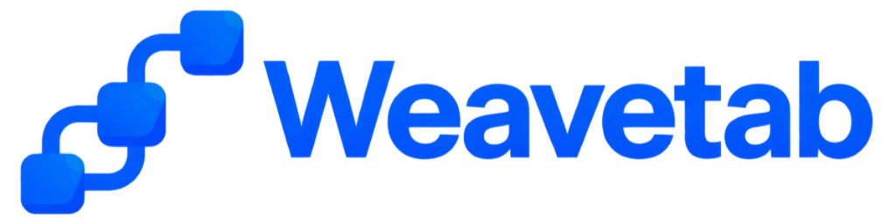
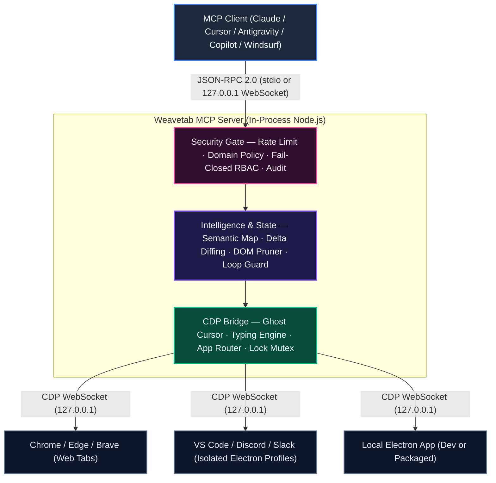

<div align="center">

<br /><br />

<p>The open automation engine for AI agents.<br />Control live browsers and desktop apps locally with instant execution.</p>

<p>
  <a href="https://github.com/Weavetab/mcp/releases"></a>
  <a href="LICENSE"></a>
  <a href="https://modelcontextprotocol.io"></a>
  
  <a href="docs/tools/tools.md"></a>
  <a href="https://glama.ai/mcp/servers/Weavetab/mcp"></a>

</p>

<p>
  <a href="docs/tools/tools.md">Tool Reference</a> &nbsp;&middot;&nbsp;
  <a href="docs/DOCUMENTATION.md">Documentation</a> &nbsp;&middot;&nbsp;
  <a href="ARCHITECTURE.md">Architecture</a> &nbsp;&middot;&nbsp;
  <a href="SUPPORT.md">Support</a> &nbsp;&middot;&nbsp;
  <a href="SECURITY.md">Security</a>
</p>

</div>

---

Weavetab is the open automation engine for AI agents. It connects models directly to live Chromium browsers and Electron desktop applications via native **Chrome DevTools Protocol (CDP)** sockets — no WebDriver binaries, no cloud relay, zero telemetry.

Actions execute directly over local CDP sockets without external driver overhead. Web pages are translated into agent-readable semantic maps with turn-by-turn diffing that transmits only structural changes between turns. Built-in security enforces local domain policies, role-based access control, and client-side credential injection.

Built by [Weavetab](https://weavetab.dev), architected by [fy2ne](https://github.com/fy2ne).

---

## Design Philosophy

Most browser automation stacks for agents wrap an existing test runner behind an RPC layer. That works for a prototype and breaks down in production. Weavetab is built around four engineering constraints:

1. **Talk to the engine directly.** Chromium browsers and Electron desktop apps already expose the Chrome DevTools Protocol over a local WebSocket. Skipping WebDriver and intermediate browser wrappers removes IPC overhead, binary version skew, and process bloat.
2. **Treat context windows like memory bandwidth.** Dumping raw HTML into a model burns thousands of tokens on layout chrome and forces guessing. Weavetab walks the live accessibility and DOM trees into a compact structural map, then transmits only diffs between turns.
3. **Keep credentials outside model context.** An agent should trigger authentication without ever reading the secret. Values stay encrypted on disk, check against explicit hostname rules before injection, and get scrubbed before any tool output, snapshot, or log leaves the server.
4. **Unify browsers and desktop apps.** Discord, VS Code, Figma, and Slack all run Chromium underneath. Controlling a desktop window uses the same protocol, ref model, and security pipeline as controlling a Chrome tab, inside isolated profiles that never touch your personal app data.

| | Playwright / Puppeteer over MCP | **Weavetab** |
|---|---|---|
| **Transport** | WebDriver BiDi or external browser driver | In-process CDP WebSocket (`127.0.0.1`) |
| **Execution path** | External driver binary + IPC relay | Direct local WebSocket |
| **Targets** | Browser tabs only | Chromium browsers + Electron desktop apps |
| **Page representation** | Full HTML or verbose accessibility dump | Structural map with turn-by-turn semantic deltas |
| **Repeat observations** | Re-sends full snapshot every turn | Sends only added, changed, or removed nodes |
| **Credentials** | Passed through tool arguments in plaintext | Server-side blind injection with recursive redaction |
| **Extension surface** | Restricted | Native MV3 extension + isolated Shadow DOM HUD |

---

## Architecture



Everything runs locally in one Node.js process with zero cloud relay and zero background telemetry. Every tool call passes through a single security gate before touching CDP. See [ARCHITECTURE.md](ARCHITECTURE.md) for the full pipeline specification.

---

## Quick Start

```bash
npx -y @weavetab/mcp
```

Register the server in your MCP client:

```json
{
  "mcpServers": {
    "weavetab": {
      "command": "npx",
      "args": ["-y", "@weavetab/mcp"]
    }
  }
}
```

| Client | Configuration |
|---|---|
| Claude Code | `claude mcp add weavetab -- npx -y @weavetab/mcp` |
| Claude Desktop | `~/Library/Application Support/Claude/claude_desktop_config.json` |
| Cursor | `.cursor/mcp.json` |
| Antigravity | `~/.gemini/antigravity/mcp/weavetab/` |
| VS Code Copilot | `.vscode/mcp.json` |
| Windsurf | `~/.codeium/windsurf/mcp_config.json` |

---

## How It Works

### Structural DOM Mapping & Deltas

`browser_map` converts a live page into a dense semantic tree with session-scoped ref IDs (`w:N`). Active dialogs hoist to the top, controls bind under their parent card or section heading, and repetitive nav bars collapse into one line:

```text
╔═ ACTIVE DIALOG: "Confirm Payment" ═╗
  [w:3] button "Confirm"  [w:4] button "Cancel"

┌ "Pro Plan - $49/mo"
  [w:12] button "Upgrade"   [w:13] button "View Details"
  [w:14] input val:"john@example.com"  ph:"Email address"  FOCUSED

[w:20...w:38] 18 nav links: "Dashboard" ... "Sign out"
```

Subsequent reads compute property-level diffs against the last snapshot (`+` added, `~` changed, `-` removed), sending only what changed since the previous turn. For canvas and WebGL apps with sparse DOM trees, visual Set-of-Marks grounding overlays numbered badges directly on the rendered viewport.

### Physical Input Kinematics

Synthetic DOM events fail on modern web apps and trigger anti-automation heuristics. Weavetab drives pointer and keyboard actions through raw CDP input events: Bezier cursor trajectories with natural acceleration and jitter, single-call multi-level flyout menu traversal, and human-paced keystroke bursts with live focus recovery.

### Blind Credential Injection

Store passwords, 2FA seeds, or account credentials once on the host:

```bash
weavetab secrets set ACCOUNT_PASSWORD
```

The agent passes only the key name to `browser_type_secret`. The server verifies the active tab hostname against the key's allowed domains, decrypts locally with fail-closed AES-256-GCM, and types directly via CDP. The plaintext value never enters tool responses, DOM maps, screenshots, snapshots, memory profiles, or audit logs. Details in [docs/architecture/blind-injection.md](docs/architecture/blind-injection.md).

### Desktop & Electron Automation

Any tool accepts an `app` target to route execution to a registered Electron application instead of a browser tab. Web sessions and desktop apps run concurrently on independent debug ports, each bound to an isolated profile under `~/.weavetab-system/apps/` so personal logins and OS app directories remain untouched. See [docs/desktop-automation/electron-apps.md](docs/desktop-automation/electron-apps.md).

---

## Security Model

Weavetab treats visited web pages and third-party plugins as untrusted by default. Full threat model and vulnerability reporting live in [SECURITY.md](SECURITY.md) and [docs/architecture/security.md](docs/architecture/security.md).

| Surface | Guarantee |
|---|---|
| **Transport** | Loopback-only (`127.0.0.1` / `[::1]`) for CDP and `--ws` daemon, with per-socket 256-bit shared-secret auth and `Origin`/`Host` verification. |
| **Domain Policy** | Specificity-ordered `allow`, `read-only`, `deny`, and `audit-only` rules with wildcard and subdomain matching (`*.bank.*` and `paypal.com` blocked by default). |
| **RBAC** | Five fail-closed roles (`operator`, `viewer`, `automation`, `system`, `admin`) with action-level read-only gating so `viewer` cannot execute scripts, mutate cookies, or open tabs. |
| **Secrets & Output** | Owner-restricted key files (`0o600` / Windows ACLs), fail-closed decryption, visual capture masking, and recursive redaction across every read tool, snapshot, and log file. |
| **Isolation** | Real browser and OS AppData directories are hard-blocked; dangerous Chromium launch flags are stripped; webpages receive zero host paths or config secrets. |
| **Plugins** | Three-tier trust verification, manifest-only permissions, `realpathSync` sandbox containment on entrypoints and storage, and opt-in workspace loading. |
| **Runtime Safety** | Per-tab stuck-loop breaker halts runaway retries; mission audit logs auto-prune to bounded retention; telemetry stays off unless enabled. |

Report vulnerabilities privately to `security@weavetab.dev`.

---

## Tool Surface

40 built-in tools across 7 groups. Full parameter specs live in [docs/tools/tools.md](docs/tools/tools.md) and the auto-generated [docs/TOOLS.md](docs/TOOLS.md).

| Group | Tools |
|---|---|
| **Vision & DOM** | `browser_map` `browser_find` `browser_scrape` `browser_inspect` `browser_snapshot` `browser_screenshot` `browser_console` |
| **Input & Interaction** | `browser_click` `browser_type` `browser_type_secret` `browser_key` `browser_pointer` `browser_select` `browser_fill` `browser_upload` `browser_scroll` |
| **Navigation & Environment** | `browser_navigate` `browser_tabs` `browser_detect` `browser_viewport` `browser_emulate` |
| **Pipelines & Recording** | `browser_burst` `browser_automation` `browser_recording` `browser_pattern_learn` |
| **Oversight & Timing** | `browser_dialog` `browser_thoughts` `browser_clipboard` `browser_wait` `browser_captcha` |
| **Network & State** | `browser_network_intercept` `browser_storage` `browser_cookies` `browser_checkpoint` `browser_performance` |
| **Documents & Canvas** | `browser_office` `browser_pdf` `browser_eval` `browser_canvas` `browser_highlight` |

---

## CLI & Extensibility

```bash
weavetab                        # Run MCP server over stdio (default)
weavetab --ws --port 3000       # Run authenticated loopback WebSocket daemon
weavetab config                 # Interactive setup wizard (~/.weavetab/config.json)
weavetab secrets set KEY_NAME   # Encrypt and store a domain-scoped secret
weavetab plugin add <package>   # Verify and install a plugin
```

Build custom tools, MCP resources, slash prompts, and lifecycle hooks with the typed SDK:

```bash
npx @weavetab/sdk init my-plugin
```

Configuration options live in [docs/configuration/configuration.md](docs/configuration/configuration.md). Plugin authoring and manifest permissions live in [docs/PLUGINS.md](docs/PLUGINS.md).

---

## License

AGPL-3.0-only. Connecting an MCP client or model over stdio or WebSocket does not extend copyleft obligations to your application.

For commercial embedding, closed-source SaaS, or enterprise licensing, see [COMMERCIAL.md](../COMMERCIAL.md) or email `license@weavetab.dev`.

[Sponsor on Ko-fi](https://ko-fi.com/fy2ne) &nbsp;&middot;&nbsp; [Discussions](https://github.com/Weavetab/mcp/discussions) &nbsp;&middot;&nbsp; [SUPPORT.md](SUPPORT.md)
