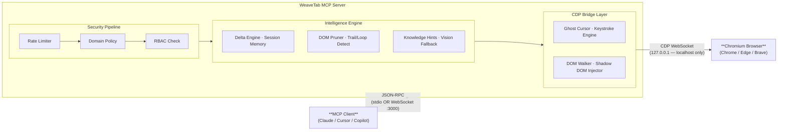

<div align="center">
  


  <h1>WeaveTab MCP</h1>
  <p><strong>Direct Layer 0 interface for AI agents across web and desktop applications.</strong></p>
  <p><em>No WebDriver. No Cloud. Pure Control.</em></p>

  <p>
    
    
    
    
    
    
  </p>

  <p>
    <a href="https://github.com/weavetab/mcp">GitHub</a> ·
    <a href="docs/TOOLS.md">Tool Reference</a> ·
    <a href="docs/DOCUMENTATION.md">Documentation</a> ·
    <a href="SECURITY.md">Security Policy</a> ·
    <a href="CONTRIBUTING.md">Contributing</a>
  </p>
</div>

---

**Weavetab** is a local, high-performance [Model Context Protocol (MCP)](https://modelcontextprotocol.io) server providing AI agents with direct, physical control across Chromium browsers and Electron desktop applications (Discord, VS Code, Antigravity, Figma, Slack, and local projects). Communicating directly over the **Chrome DevTools Protocol (CDP) WebSocket at Layer 0**, Weavetab eliminates WebDriver binaries, browser wrappers, and cloud middleware for deterministic **3–8ms tool execution latency**.

Built by **fy2ne**, Weavetab is engineered for autonomous AI agents operating in production environments where latency, security, and token efficiency are non-negotiable.

---

## Table of Contents

- [Quick Start](#quick-start)
- [Architecture](#architecture)
- [Core Features](#core-features)
- [Electron & Desktop App Automation](#electron--desktop-app-automation)
- [Tool Categories](#tool-categories)
- [CLI Reference](#cli-reference)
- [Configuration](#configuration)
- [Secrets Management](#secrets-management)
- [MCP Client Integration](#mcp-client-integration)
- [Development Environment](#development-environment)
- [Plugin System](#plugin-system)
- [Weavetab Skills Ecosystem](#weavetab-skills-ecosystem)
- [Security Model](#security-model)
- [Feature Comparison](#feature-comparison)
- [Contributing](#contributing)

---

## Quick Start

### Quick Run with npx (Recommended)

```bash
# Run directly with npx
npx -y @weavetab/mcp
```

### Or Install Globally via npm

```bash
# Install globally
npm install -g @weavetab/mcp

# Launch the MCP server
weavetab
```

### Verify Installation

```bash
weavetab --version
# → @weavetab/mcp 2.5.0

weavetab help
# → Full CLI usage
```

### Connect to an MCP Client

Add to your MCP client configuration (e.g., `claude_desktop_config.json`):

```json
{
  "mcpServers": {
    "weavetab": {
      "command": "npx",
      "args": ["-y", "@weavetab/mcp"]
    }
  }
}
```

---

## Architecture

Weavetab operates as the execution layer between an MCP client and a live Chromium browser. Every tool invocation travels through a security-hardened, multi-stage pipeline before a single byte touches the browser.



### Five Architectural Layers

| Layer | Components | Responsibility |
|-------|-----------|----------------|
| **Transport** | stdio (JSON-RPC), WebSocket (port 3000) | MCP client communication |
| **Security & Governance** | Domain blacklist, Rate limiter, RBAC (4 roles), Root guard, Storage blocker | Pre-flight security checks |
| **Intelligence** | Session memory, Semantic Delta engine, DOM pruner, Trail/loop detection, Knowledge hints, Vision fallback | Token optimization, self-learning |
| **Sensor Systems** | Network telemetry, DOM mutations, Human pacing, Agent state machine, Thought HUD | Runtime awareness |
| **CDP Bridge** | DOM walker, Ghost cursor, Keystroke engine, Pruner, Shadow DOM injector, Tab manager, Browser launcher | Raw browser control |

### Transport Modes

| Mode | Protocol | Use Case |
|------|----------|----------|
| **stdio** (default) | JSON-RPC over stdin/stdout | Claude Desktop, Cursor, Copilot, all standard MCP clients |
| **WebSocket** (`--ws`) | JSON-RPC over WebSocket, port 3000 | Custom integrations, remote agent pipelines |

---

## Core Features

### Semantic Delta Engine
Instead of dumping the full DOM on every `browser_map` call, the Delta Engine stores a per-tab snapshot and returns **only what changed**. This reduces token consumption by **5–10× on repeated reads**. Combined with the Semantic DOM Pruner (which drops hidden non-interactive elements and collapses SVG icons to `[SVG Icon: label]` tokens), agents receive minimal, actionable context.

```
browser_map({ prune: true, delta: true })  →  Maximum token efficiency
```

### Ghost Cursor
Every click dispatches a physics-realistic **Bézier curve trajectory** — not a raw coordinate warp. Acceleration, jitter, and hold-duration are sampled from a human motion profile, making automation indistinguishable from human input at the DOM event level.

### Human Typing Engine
Keystrokes are dispatched with **per-character jitter**, **burst-pattern profiling** (humans type fast in bursts, slow at boundaries), and natural inter-word pauses. The engine includes real-time DOM-diffing to detect and break stuck-typing loops.

### Blind Injection (`browser_type_secret`)
> [!IMPORTANT]
> Enterprise-grade credential injection that **never exposes secret values to the LLM context**. Secrets are resolved from `~/.weavetab/secrets.json` (or a project-scoped `.weavetab/secrets.json`) with per-domain scoping. The injected value is permanently masked as `[REDACTED]` in all subsequent DOM snapshots, delta maps, and audit logs.

### Session Memory
Each domain visited builds a persistent profile on disk at `~/.weavetab-system/memory/`. The system auto-detects frontend frameworks (React, Vue, Angular, Lit, Svelte, Next, Nuxt, Gatsby) via `Runtime.evaluate`. Strategies and known inputs accumulate across sessions, enabling progressive improvement.

```json
{
  "framework": "react",
  "shadowDom": true,
  "strategies": ["click_nav_menu", "type_search"],
  "knownInputs": [{ "label": "Search", "selector": "#search" }],
  "visitCount": 12,
  "updatedAt": "2026-07-20T..."
}
```

### Loop Detection & Trail System
> [!WARNING]
> A rolling window of the last 50 tool actions is maintained in `~/.weavetab-system/sessions/context.json`. A strike-based algorithm detects stuck loops:

| Strikes | Severity | Behavior |
|---------|----------|----------|
| < 5 | None | Normal operation |
| 5–9 | Warning | HUD reports potential loop |
| 10+ | Critical | Agent state → "stuck"; auto-recovery attempted |

Use `browser_reset_loop_counter` to manually clear the counter.

### Vision Fallback System
When the CDP Accessibility Tree returns zero elements (canvas-heavy pages, fully custom UIs), Weavetab falls back to local pixel analysis via the `sharp` library — **zero external API calls, zero ML dependencies**:

```
CDP AX Tree Empty → Capture Screenshot → Grayscale Conversion
→ 4×4 Grid Heatmap → Text Density Calculation → Clickable Zone Detection
→ Page State Classification
```

### ⚡ Burst Mode
Chain N actions in a single MCP round-trip with `browser_burst`. Supports macro steps: `type_and_send`, `navigate_and_read`, `click_and_wait`, `scroll_and_read`. Eliminates the per-tool JSON-RPC overhead for high-throughput workflows.

---

## Electron & Desktop App Automation

Weavetab extends its Layer 0 CDP engine beyond web browsers to **any Electron-based desktop application or locally hosted webview app** (e.g. **Discord**, **Slack**, **VS Code**, **Antigravity IDE**, **Figma**, **Obsidian**, **Postman**, or your own custom Electron projects running from source).

Because Electron is built on Chromium and Blink, Weavetab controls desktop apps using the exact same low-latency CDP primitives (`browser_map`, `browser_click`, `browser_type`, `browser_tabs`, etc.) with zero app-specific hacks or overhead.

### 1. Configuring Installed Desktop Apps

Add your application executable paths to `~/.weavetab/config.json` (or `./.weavetab/config.json`) under the `"electron"` dictionary:

```json
{
  "browserType": "chromium",
  "electron": {
    "discord": "C:\\Users\\<user>\\AppData\\Local\\Discord\\app-1.0.9183\\Discord.exe",
    "antigravity": "C:\\Users\\<user>\\AppData\\Local\\Programs\\antigravity\\Antigravity.exe",
    "vscode": "C:\\Users\\<user>\\AppData\\Local\\Programs\\Microsoft VS Code\\Code.exe",
    "figma": "C:\\Users\\<user>\\AppData\\Local\\Figma\\Figma.exe",
    "obsidian": "C:\\Users\\<user>\\AppData\\Local\\Obsidian\\Obsidian.exe",
    "slack": "/Applications/Slack.app/Contents/MacOS/Slack"
  }
}
```

### 2. Automating Local / Source-Hosted Electron Projects

If you are developing a local Electron app from source code or running it via Vite / Webpack / Next.js on `localhost`, you can automate it in two ways:

#### Option A: Launch with Remote Debugging Flag
Start your development process passing the Chrome DevTools Protocol remote debugging port:

```bash
# Standard Electron CLI / npm script
npx electron . --remote-debugging-port=9222

# Or within your package.json scripts:
# "dev:debug": "electron . --remote-debugging-port=9222"
npm run dev:debug
```

Then configure `"attachPort": 9222` in `.weavetab/config.json` or register it in `"electron"`:
```json
{
  "electron": {
    "my-dev-app": "npm run dev:debug"
  }
}
```

#### Option B: Register Local App Executable / Wrapper Script
Specify your local build binary or launch script in `"electron"`:
```json
{
  "electron": {
    "my-local-app": "C:\\Users\\<user>\\projects\\my-app\\node_modules\\electron\\dist\\electron.exe"
  }
}
```

### 3. Controlling Desktop Apps via MCP Tools

All Weavetab tools accept an optional `app` parameter specifying which application to target. When specified, Weavetab automatically connects to that app's dedicated CDP session without launching or interfering with your default browser.

#### Launch / Focus Desktop App
```json
{
  "name": "browser_navigate",
  "arguments": {
    "app": "antigravity"
  }
}
```

#### List & Switch Windows / Workbenches
Desktop apps often run multiple browser windows or background webviews. Inspect and switch active contexts using `browser_tabs`:
```json
{
  "name": "browser_tabs",
  "arguments": {
    "action": "list",
    "app": "antigravity"
  }
}
```

Switch to a specific window/tab:
```json
{
  "name": "browser_tabs",
  "arguments": {
    "action": "switch",
    "tabId": "D8832CBF1FEF413B6E09E96EF8C82DFF",
    "app": "antigravity"
  }
}
```

#### Inspect DOM & Interact with UI Elements
Generate actionable Ref IDs (`w:NN`) and interact directly with native desktop UI components:
```json
// 1. Snapshot the Desktop App UI
{
  "name": "browser_map",
  "arguments": {
    "app": "antigravity"
  }
}

// 2. Click Settings or Menus
{
  "name": "browser_click",
  "arguments": {
    "ref": "w:14",
    "app": "antigravity"
  }
}

// 3. Type text into Desktop inputs
{
  "name": "browser_type",
  "arguments": {
    "ref": "w:28",
    "text": "Hello from WeaveTab automation!",
    "app": "discord"
  }
}
```

---

## Tool Categories

Weavetab exposes **44+ MCP tools** organized into functional categories. See the complete reference in [`docs/TOOLS.md`](docs/TOOLS.md).

### Vision & Reading (7 tools)
| Tool | Description |
|------|-------------|
| `browser_map` | DOM enumeration with volatile `w:NN` ref IDs that invalidate after DOM mutations. Supports delta mode, semantic pruning, AX tree fallback, scope & query filtering |
| `browser_find` | Native CDP text search — ~10× cheaper than map |
| `browser_scrape` | CSS/XPath (Note: XPath lacks shadow-DOM support) structured data extraction |
| `browser_inspect` | Computed CSS styles + event listener types |
| `browser_snapshot` | MHTML capture/restore of full DOM state |
| `browser_screenshot` | PNG/JPEG capture, full-page + clip region, returns base64 (no file pollution) |
| `browser_console` | Read/clear buffered console logs & exceptions |

### Navigation (1 tool)
| Tool | Description |
|------|-------------|
| `browser_navigate` | Navigate to URL with domain blocklist enforcement & `weavetab://` protocol support |

### Input (9 tools)
| Tool | Description |
|------|-------------|
| `browser_click` | Ghost Cursor (Bézier) click with multi-strategy fallback and intent memory |
| `browser_type` | Human keystroke engine with jitter, burst patterns, and stuck-loop detection |
| `browser_type_secret` | **Blind Injection** — resolves credentials from `secrets.json`, never exposes to LLM |
| `browser_key` | Native keyboard dispatch with modifier keys (Ctrl, Shift, Alt, Meta) |
| `browser_pointer` | Hover, double-click, drag-and-drop with Ghost Cursor trajectory |
| `browser_select` | Native `<select>` dropdown selection (React/Vue safe via prototype setter) |
| `browser_fill` | Smart multi-field form fill with per-field type detection |
| `browser_upload` | Bypass file dialogs via CDP `DOM.setFileInputFiles` |
| `browser_scroll` | Directional + element-relative scroll via CDP wheel events |

### Tabs & Windows (2 tools)
| Tool | Description |
|------|-------------|
| `browser_tabs` | Open/switch/close/list/consolidate/heal tabs and windows |
| `browser_detect` | Detect installed browsers + CDP feature coverage per engine |

### Mission Execution (3 tools)
| Tool | Description |
|------|-------------|
| `browser_burst` | Chain N actions in 1 MCP call — highest throughput mode |
| `browser_plan` | Live task dashboard in browser Shadow DOM overlay |
| `browser_automation` | Inject persistent self-running background scripts |

### Dialog & User Interaction (3 tools)
| Tool | Description |
|------|-------------|
| `browser_dialog` | Accept/dismiss JavaScript alert/confirm/prompt dialogs |
| `browser_thought` | Green thought-bubble HUD: `feedback` (one-way) or `question` (with input) |
| `browser_clipboard` | System clipboard R/W (text + images) |

### Wait & Timing (2 tools)
| Tool | Description |
|------|-------------|
| `browser_wait` | Wait for element/text/URL/stable/network/auto |
| `browser_reset_loop_counter` | Manual loop detection override |

### Storage & Cookies (2 tools)
| Tool | Description |
|------|-------------|
| `browser_storage` | `localStorage` & `sessionStorage` get/set/clear |
| `browser_cookies` | Cookies get/set/delete/get_all |

### Device & Environment (1 tool)
| Tool | Description |
|------|-------------|
| `browser_viewport` | Viewport resize, mobile emulation, geolocation, timezone, locale, color scheme |

### Network (1 tool)
| Tool | Description |
|------|-------------|
| `browser_network_intercept` | Mock API responses, block tracking, and retrieve raw protocol network telemetry (TLS/SSL certificate metadata, microsecond timing breakdown, OS-level failure reasons) |

### Canvas & Visual (2 tools)
| Tool | Description |
|------|-------------|
| `browser_canvas` | Get image data or draw points on `<canvas>` elements |
| `browser_highlight` | Visual CDP overlay highlight — zero token cost |

### Output (2 tools)
| Tool | Description |
|------|-------------|
| `browser_pdf` | Print page to PDF (landscape, scale, page ranges) |
| `browser_recording` | Compile browser screencast frames into video (.webp, .gif, .mp4, .webm) |

### Evaluation (1 tool)
| Tool | Description |
|------|-------------|
| `browser_eval` | Run arbitrary JS via `CDP Runtime.evaluate` |

### Performance (1 tool)
| Tool | Description |
|------|-------------|
| `browser_performance` | FCP, LCP, TTI metrics and resource timings |

### Macro (1 tool)
| Tool | Description |
|------|-------------|
| `browser_macro_compile` | Compile successful trails into reusable burst macros |

### GitHub (4 tools)
| Tool | Description |
|------|-------------|
| `github_analyze` | Repo metadata, file tree, README snippet |
| `github_read` | Read file contents via raw.githubusercontent.com (no API rate limit) |
| `github_issues` | List/search/fetch issues with comments |
| `github_get_pr` | PR details + changed files + comments |

### Utility (1 tool + Plugin System)
| Tool | Description |
|------|-------------|
| `Weavetab_logs` | Append agent feedback to mission log |
| Plugins | Dynamic tool loading from any npm package with `weavetab.json` (or `@weavetab/plugin-*`) |

---

## CLI Reference

The `weavetab` CLI provides server management, secrets handling, and diagnostics.

### Server Commands

```bash
# Start the MCP server (stdio mode — default for MCP clients)
# Start the MCP server
Weavetab

# Interactive configuration wizard
Weavetab config

# View current state
Weavetab view

# Reset session cache
Weavetab reset
```

### Secrets Management

Credentials are stored in `~/.weavetab/secrets.json` (global) or `.weavetab/secrets.json` (project-scoped). The CLI provides safe management without ever echoing values to the terminal.

```bash
# Initialize project-scoped secrets store
Weavetab secrets init --project

# Add or update a secret (prompts securely, value never echoed)
Weavetab secrets set MY_API_KEY

# List all secrets (names only, values hidden)
Weavetab secrets list

# Remove a secret
Weavetab secrets rm MY_API_KEY
```

### Reset & Diagnostics

```bash
# Clear all session state (loop counter, memory snapshots)
Weavetab reset
```

---

## Configuration

Weavetab auto-generates a config file at `~/.weavetab/config.json` on first run. All values can be overridden with a project-scoped `.weavetab/config.json`.

```json
{
  "browserType": "chromium",
  "headless": false,
  "devMode": false,
  "maxActionsPerMinute": 60,
  "role": "admin",
  "telemetry": false,
  "downloadDir": "~/Downloads",
  "profileDir": "~/.weavetab/profile",
  "electron": {
    "discord": "C:\\Users\\<user>\\AppData\\Local\\Discord\\app-1.0.9183\\Discord.exe",
    "antigravity": "C:\\Users\\<user>\\AppData\\Local\\Programs\\antigravity\\Antigravity.exe"
  }
}
```

| Key | Type | Default | Description |
|-----|------|---------|-------------|
| `browserType` | `"chromium"` \| `"firefox"` \| `"webkit"` | `"chromium"` | Which browser to launch/attach |
| `headless` | boolean | `false` | Run browser without a window |
| `devMode` | boolean | `false` | Verbose CDP logging |
| `maxActionsPerMinute` | number | `60` | Rate limit threshold |
| `role` | `"admin"` \| `"system"` \| `"viewer"` \| `"automation"` | `"admin"` | RBAC role |
| `telemetry` | boolean | `false` | Opt-in telemetry |
| `electron` | `Record<string, string>` | `{}` | Named map of Electron desktop apps to executable paths or startup scripts |

### Domain Policy

Configure per-domain policies in `~/.weavetab/policy.json`:

```json
{
  "policies": [
    { "pattern": "*.banking.com", "mode": "deny" },
    { "pattern": "*.internal.corp", "mode": "read-only" },
    { "pattern": "staging.myapp.com", "mode": "audit" }
  ]
}
```

Available modes: `allow`, `read-only`, `deny`, `audit`.

---

## Secrets Management

Weavetab's **Blind Injection** system keeps credentials permanently out of the LLM context.

### How It Works

1. You store a secret via `Weavetab secrets set MY_KEY` or by editing `secrets.json` directly
2. The agent calls `browser_type_secret({ id: "w:2", envKey: "MY_KEY" })`
3. Weavetab resolves the value from `secrets.json` **server-side** — the LLM never sees it
4. The value is injected directly into the DOM input field
5. All subsequent `browser_map`, delta, and AX tree outputs show `[REDACTED]` for that node

### Secrets File Format

```json
{
  "MY_API_KEY": {
    "value": "sk-prod-...",
    "domains": ["api.example.com", "app.example.com"],
    "description": "Production API key"
  },
  "ADMIN_PASSWORD": {
    "value": "hunter2",
    "domains": ["admin.example.com"],
    "description": "Admin panel password"
  }
}
```

### Resolution Priority

| Priority | Location | Purpose |
|----------|----------|---------|
| 1st | `./.weavetab/secrets.json` | Project-scoped (opt-in via `Weavetab secrets init --project`) |
| 2nd | `~/.weavetab/secrets.json` | Global default |

> [!NOTE]
> The legacy `.env`-based `EnvSecretProvider` is deprecated and no longer supported. All secrets must be stored in `secrets.json`.

---

## MCP Client Integration

Weavetab connects out-of-the-box via stdio JSON-RPC 2.0 with all major AI coding assistants and IDEs.

| Environment | Setup Method | Guided Web Installer |
| :--- | :--- | :--- |
| **Cursor** | `.cursor/mcp.json` | [weavetab.dev/mcp/install/cursor](https://weavetab.dev/mcp/install/cursor) |
| **Antigravity** | `~/.gemini/antigravity/mcp/` | [weavetab.dev/mcp/install/antigravity](https://weavetab.dev/mcp/install/antigravity) |
| **Claude Desktop** | `claude_desktop_config.json` | [weavetab.dev/mcp/install/claude-desktop](https://weavetab.dev/mcp/install/claude-desktop) |
| **Claude Code** | `claude mcp add` | [weavetab.dev/mcp/install/claude-code](https://weavetab.dev/mcp/install/claude-code) |
| **VS Code / Copilot** | 1-Click Protocol / `settings.json` | [weavetab.dev/mcp/install/vscode](https://weavetab.dev/mcp/install/vscode) |
| **Windsurf** | `mcp_config.json` | [weavetab.dev/mcp/install/windsurf](https://weavetab.dev/mcp/install/windsurf) |

---

### Cursor

Add to `.cursor/mcp.json` in your project root or in **Cursor Settings > MCP**:

```json
{
  "mcpServers": {
    "weavetab": {
      "command": "npx",
      "args": ["-y", "@weavetab/mcp"]
    }
  }
}
```

---

### Antigravity

Register Weavetab in your Antigravity configuration or workspace `.gemini/settings.json`:

```json
{
  "mcpServers": {
    "weavetab": {
      "command": "npx",
      "args": ["-y", "@weavetab/mcp"]
    }
  }
}
```

---

### Claude Desktop

Add to your platform's configuration file:
- **macOS:** `~/Library/Application Support/Claude/claude_desktop_config.json`
- **Windows:** `%APPDATA%\Claude\claude_desktop_config.json`
- **Linux:** `~/.config/Claude/claude_desktop_config.json`

```json
{
  "mcpServers": {
    "weavetab": {
      "command": "npx",
      "args": ["-y", "@weavetab/mcp"]
    }
  }
}
```

---

### Claude Code

Run the terminal command to register Weavetab globally:

```bash
claude mcp add weavetab -- npx -y @weavetab/mcp
```

Or for project-scoped activation:

```bash
claude mcp add --scope project weavetab -- npx -y @weavetab/mcp
```

---

### Visual Studio Code & Copilot

Add to `.vscode/settings.json` or User Settings:

```json
{
  "mcpServers": {
    "weavetab": {
      "command": "npx",
      "args": ["-y", "@weavetab/mcp"]
    }
  }
}
```

---

### Windsurf

Add to `~/.codeium/windsurf/mcp_config.json`:

```json
{
  "mcpServers": {
    "weavetab": {
      "command": "npx",
      "args": ["-y", "@weavetab/mcp"]
    }
  }
}
```

---

### WebSocket Mode (Custom Agent Pipelines & SDKs)

Launch a standalone WebSocket daemon:

```bash
weavetab --ws --port 3000
```

```javascript
// Connect from any custom client or script
const ws = new WebSocket("ws://localhost:3000");
ws.send(JSON.stringify({ jsonrpc: "2.0", id: 1, method: "tools/list" }));
```

---

## Development Environment

### Prerequisites

- **Node.js 18+** (LTS recommended)
- **npm 8+**
- A **Chromium-based browser** (Chrome, Edge, Brave)
- **Git**

### Source Code Setup

```bash
# Clone the repository
git clone https://github.com/weavetab/mcp.git
cd mcp

# Install dependencies
npm install

# Start in development mode (tsx watcher — auto-reloads on file changes)
npm run dev

# Build the project
npm run build       # Builds extension + HUD + TypeScript
npm run build:ext   # Extension only
npm run build:hud   # Shadow DOM HUD only

# Run the MCP server from source
node dist/index.js
```

### Project Structure

```
src/
├── cdp/            # Chrome DevTools Protocol bridge (walker, connector, lock, pruner, ghost)
├── intelligence/   # Session memory, delta engine, trail, hints, vision fallback, intent
├── sensors/        # Network telemetry, DOM mutations, human pacing, wait guards, thoughts HUD
├── security/       # Domain blacklist, rate limiter, RBAC, Blind Injection secrets
├── state/          # Delta engine, agent state machine, session registry, mutation cache
├── tools/          # 44+ individual tool implementations
│   └── github/     # GitHub API integration tools
├── overlay/        # Shadow DOM UI injector, Ghost cursor, thought bubble HUD
├── audit/          # Structured logging & telemetry
├── plugin/         # Plugin interface and dynamic loader
├── config/         # Multi-source config merge & live reload
├── cli/            # CLI utilities and update notifier
├── anticaptcha/    # CAPTCHA detection and solving strategies
├── server.ts       # MCP server entry point — all tool registrations
└── index.ts        # CLI entry point (wizard, reset, main interactive UI)
```

### Testing

```bash
# All tests
npm test

# Unit tests only (fast, no browser required)
npm run test:unit

# End-to-end smoke test (requires Chrome)
npm run test:e2e
```

### Docker (Headless Production)

Run Weavetab in a Docker container with a headless Chromium instance for CI/CD pipelines:

```dockerfile
FROM node:20-slim

# Install Chromium and dependencies
RUN apt-get update && apt-get install -y \
    chromium \
    --no-install-recommends && rm -rf /var/lib/apt/lists/*

# Install Weavetab MCP
RUN npm install -g @weavetab/mcp

# Set Chrome path for headless mode
ENV CHROME_PATH=/usr/bin/chromium

EXPOSE 3000

CMD ["Weavetab", "--ws", "--headless"]
```

```bash
docker build -t weavetab-server .
docker run -p 3000:3000 weavetab-server
```

### Environment Variables

| Variable | Description |
|----------|-------------|
| `CHROME_PATH` | Override Chromium binary path |
| `WEAVETAB_CONFIG` | Path to a custom config file |
| `WEAVETAB_ROLE` | Override RBAC role at runtime |
| `WEAVETAB_DEV` | `1` to enable verbose dev logging & developer mode |

### Developer Mode (`devMode`)

Setting `"devMode": true` in configuration or `WEAVETAB_DEV=1` activates diagnostic features:
* **Payload Extensions**: Adds `execution_ms` (precise latency breakdown) and `toolcalls` traces to MCP tool outputs.
* **Visual Overlays**: Renders real-time HUD execution badges, target hitboxes, and Bézier cursor trajectory curves in the browser.
* **Audit Mission Logs**: Automatically generates structured CDP event logs in `~/.weavetab/logs/` for every completed mission.

> 📖 See [docs/DEV_MODE.md](docs/DEV_MODE.md) for complete details.

---

## Plugin System

Weavetab supports dynamic tool extension via the **Plugin System**. Any npm package containing a valid `weavetab.json` manifest found in `node_modules` (or official `@weavetab/plugin-*` packages) is automatically discovered and loaded at startup. Community plugins are not restricted to any prefix—name them anything (e.g., `wt-n8n`, `seo-auditor`, `pdf-extract`).

> 📖 See [Developer Plugin Guide](../docs/dev_plugin.md) for a step-by-step tutorial, and [docs/PLUGINS.md](docs/PLUGINS.md) for the complete architecture and manifest specification.

### Quick Scaffold & Build

```bash
# 1. Interactive scaffolding wizard
npx weavetab init

# 2. Build, type-check, and auto-sync weavetab.json
npx weavetab build
```

### Installing a Plugin

```bash
# Official plugin
wt plugin add @weavetab/plugin-sample

# Community plugin (any npm name)
wt plugin add seo-auditor
# or via npm
npm install wt-n8n
```

Restart `weavetab` — the plugin's tools are automatically registered as additional MCP tools.

### Developing a Plugin

```typescript
// src/index.ts
import type { WeavetabPlugin } from "@weavetab/mcp";

const plugin: WeavetabPlugin = {
  name: "my-plugin",
  version: "1.0.0",
  tools: [
    {
      name: "my_custom_tool",
      description: "WHAT: Does something | WHEN: Use for X | EXAMPLE: my_custom_tool({ param: 'value' })",
      schema: { param: { type: "string", description: "Input parameter" } },
      handler: async (args, session, config) => {
        // Your tool implementation using Chrome DevTools Protocol session
        const evalResult = await session.evaluate(() => document.title);
        return { success: true, title: evalResult };
      }
    }
  ]
};

export default plugin;
```

Plugin tools follow the standard MCP contract: structured Zod input, deterministic JSON output, audit logging, and `WeaveError` protocol on failure.

---

## Weavetab Skills Ecosystem

The **Weavetab Skills** package (`@weavetab/skills`) is an optional companion that provides pre-built workflow patterns and mission templates for AI agents. Skills are automatically discovered by compatible MCP clients and inject context-aware guidance for mission planning.

> 🔗 **Repository:** [github.com/weavetab/skills](https://github.com/weavetab/skills)

### Installation

```bash
npm install -g @weavetab/skills
```

### Available Skills

| Skill | Description |
|-------|-------------|
| **Multi-step Form Automation** | Complex form filling with validation handling and error recovery |
| **E-commerce Checkout** | Shopping cart navigation and payment processing workflows |
| **Data Extraction Pipelines** | Structured data scraping, transformation, and export |
| **Content Management Systems** | WordPress, Drupal, and CMS-specific interaction patterns |
| **API Testing & Validation** | Endpoint testing, response verification, and contract checking |

Skills are loaded as an MCP resource layer and provide declarative mission templates that agents can reference during task planning.

---

## Security Model

Weavetab implements a defense-in-depth security architecture designed for production deployments.

### Security Mechanisms

| Mechanism | Description |
|-----------|-------------|
| **Domain Blacklist** | Hard-blocked high-risk domains (banking portals, IAM providers, cloud consoles) |
| **Domain Policy Engine** | Per-domain modes: `allow`, `read-only`, `deny`, `audit` — via `~/.weavetab/policy.json` |
| **Localhost Binding** | CDP WebSocket strictly bound to `127.0.0.1` — no external exposure |
| **Zero Cloud Dependency** | Executes entirely on local machine (no telemetry unless opted in) |
| **Rate Limiting** | Configurable actions-per-minute with mutex-based enforcement |
| **Role-Based Access Control** | 4 roles: `admin`, `operator`, `viewer`, `automation` |
| **Root Guard** | Prevents execution as root/superuser at startup (Unix) |
| **Blind Injection** | Credentials from `secrets.json` — never exposed to LLM or audit logs |
| **Input Filter** | Strips prompt injection patterns, invisible Unicode, oversized labels |
| **Shadow DOM Isolation** | All injected UIs run in isolated Shadow DOM context |
| **Storage Blocker** | Optional nullification of `localStorage`, `sessionStorage`, `document.cookie` |
| **Atomic Config Writes** | Config files written to temp then atomically renamed |
| **Path Traversal Protection** | `downloadDir` and `profileDir` validated to reject `..` traversal |
| **Two-Factor Lock Validation** | Browser lock validated by PID liveness + TCP port connectivity |

### RBAC Role Matrix

| Tool Category | admin | operator | viewer | automation |
|---------------|:-----:|:--------:|:------:|:----------:|
| All mutation tools | ✅ | ✅ | ❌ | ❌ |
| Read-only tools (map, find, scrape, screenshot, inspect, github_*, etc.) | ✅ | ✅ | ✅ | ❌ |
| burst, plan, wait, map | ✅ | ✅ | ❌ | ✅ |
| System tools (logs, detect, performance, reset_loop_counter) | ✅ | ❌ | ❌ | ❌ |

---

## Feature Comparison

| Metric | **Weavetab** | Playwright MCP | Puppeteer | Selenium |
|--------|:------------:|:--------------:|:---------:|:--------:|
| **Architecture** | Direct CDP WebSocket (Layer 0) | CDP + Node.js bridge | CDP (heavy wrapper) | WebDriver protocol |
| **Mean Latency** | **3–8ms** | 15–40ms | 10–25ms | 50–150ms |
| **Token Efficiency** | **Semantic Deltas (5–10×) + Pruning** | Full DOM dumps | Full DOM dumps | Full DOM dumps |
| **Input Simulation** | Ghost Cursor + Human Typing | Instant coordinates | Instant coordinates | Instant coordinates |
| **Cloud Dependency** | **Zero** (localhost only) | Optional | Optional | Grid required |
| **Security Model** | Blacklist + RBAC + Rate limit + Blind Injection | None | None | None |
| **Session Memory** | Persistent per-domain profiles | None | None | None |
| **MCP Native** | ✅ | ✅ | ❌ | ❌ |
| **Plugin System** | Dynamic `weavetab.json` & `@weavetab/plugin-*` loading | Yes (custom) | Yes (custom) | Yes (custom) |
| **Tool Count** | **44+ built-in + plugins** | ~25–35 | N/A | N/A |
| **Loop Detection** | Strike-based + auto-recovery | None | None | None |
| **Browser Engine** | Chromium (+ detection for Firefox/WebKit) | Chromium + Firefox + WebKit | Chromium only | All major |

---

## Contributing

Weavetab is currently in **Beta** and actively welcomes community contributions.

- 🐛 **Bug Reports:** [GitHub Issues](https://github.com/weavetab/mcp/issues)
- 💡 **Feature Requests:** [GitHub Issues](https://github.com/weavetab/mcp/issues)
- 🔧 **Pull Requests:** See [CONTRIBUTING.md](CONTRIBUTING.md) for guidelines
- 🔒 **Security:** See [SECURITY.md](SECURITY.md) — do **not** open public issues for vulnerabilities

### Quick Contribution Guide

```bash
git clone https://github.com/weavetab/mcp.git
cd mcp
npm install
npm run dev      # Start dev watcher
npm test         # Run all tests before submitting a PR
```

Commit format: `feat:`, `fix:`, `docs:`, `chore:`, `refactor:`, `test:`

---

## License & Enterprise Clarification

**AGPL-3.0-only** — See [LICENSE](LICENSE) for full details.

### MCP Transport Clarification
Running Weavetab MCP as an independent process and communicating with it over standard Model Context Protocol transports (`stdio` or WebSocket JSON-RPC) does **not** cause AGPL copyleft obligations to extend to your client application, IDE, or host AI models.

### Commercial Licensing
For commercial, proprietary, or embedded distribution without AGPL copyleft requirements, dual-licensing options are available. Inquire at `license@weavetab.dev`.

---

## Support

| Channel | Purpose |
|---------|---------|
| [GitHub Issues](https://github.com/weavetab/mcp/issues) | Bug reports, feature requests |
| [TROUBLESHOOTING.md](TROUBLESHOOTING.md) | Common issues and fixes |
| [docs/](docs/) | Full documentation |
| security@weavetab.dev | Security vulnerabilities (private) |

---

## Acknowledgments

Built by **fy2ne** with gratitude to the [Model Context Protocol](https://modelcontextprotocol.io) community and the Chrome DevTools Protocol team for making browser automation at Layer 0 possible.

---

> [!NOTE]
> **Beta Release Notice:** This is v2.5.0 Beta. APIs and features may evolve as we approach stable release. Report issues on [GitHub](https://github.com/weavetab/mcp/issues).
