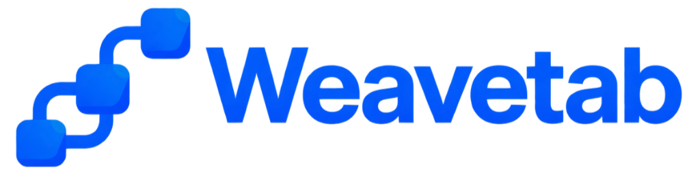

<div align="center">

<br /><br />

<p>The open automation engine for AI agents.<br />Control live browsers and desktop apps locally with instant execution.</p>

<p>
  <a href="https://github.com/weavetab/mcp/releases"></a>
  <a href="LICENSE"></a>
  <a href="https://modelcontextprotocol.io"></a>
  
  <a href="docs/tools/tools.md"></a>
  <a href="https://github.com/sponsors/fy2ne"></a>
</p>

<p>
  <a href="docs/tools/tools.md">Tool Reference</a> &nbsp;&middot;&nbsp;
  <a href="docs/DOCUMENTATION.md">Documentation</a> &nbsp;&middot;&nbsp;
  <a href="ARCHITECTURE.md">Architecture</a> &nbsp;&middot;&nbsp;
  <a href="SUPPORT.md">Support</a> &nbsp;&middot;&nbsp;
  <a href="SECURITY.md">Security</a>
</p>

</div>

---

Weavetab is the open automation engine for AI agents. It connects models directly to live Chromium browsers and Electron desktop applications via native **Chrome DevTools Protocol (CDP)** sockets — no WebDriver binaries, no cloud relay, zero telemetry.

Actions execute with **sub-10ms latency**. Web pages are translated into agent-readable semantic maps with turn-by-turn diffing that reduces token usage by **up to 95%**. Built-in security enforces local domain policies, role-based access control, and client-side credential injection.

Built and architected by [fy2ne](https://github.com/fy2ne).

---

## Why not Playwright or Puppeteer?

> The standard approach — Playwright over MCP — works. But it carries fundamental architectural costs that compound at scale.

|  | Playwright / Puppeteer | **Weavetab** |
|---|---|---|
| **Protocol layer** | WebDriver BiDi or CDP via browser binary | Raw CDP WebSocket, Layer 0 |
| **Tool execution latency** | 50–300 ms (binary + IPC overhead) | **3–8 ms** |
| **Desktop app control** | Browser only | Chrome + any Electron app (Discord, VS Code, Figma…) |
| **DOM representation** | Full HTML dump to LLM | Semantic Map 3.0 with delta diffing |
| **Token cost per map** | ~2,000–8,000 tokens | **~80–400 tokens** (95% reduction via delta) |
| **CAPTCHA** | API service required | **Zero-API** via CDP mouse physics |
| **Credential safety** | Secrets passed in plaintext | **Blind Injection** — never in LLM context |
| **Extension access** | Limited | Full Chrome Extension API surface |

---

## Architecture

```
MCP Client (Claude / Cursor / Antigravity / Copilot / Windsurf)
       |
       |  JSON-RPC 2.0  (stdio or WebSocket 127.0.0.1:3000)
       v
+-------------------------------------------------------------+
|                   Weavetab MCP Server                       |
|                                                             |
|  +-----------------+   +---------------------------------+  |
|  | Security Layer  |-->|  Intelligence Engine            |  |
|  | Rate · RBAC     |   |  Map 3.0 · Delta · Memory       |  |
|  | Policy · Audit  |   |  Pruner · Framework Detector    |  |
|  +-----------------+   +----------------+----------------+  |
|                                         |                   |
|                              +----------v----------------+  |
|                              |  CDP Bridge               |  |
|                              |  Ghost Cursor · Typing    |  |
|                              |  App Router · Loop Guard  |  |
|                              +----------+----------------+  |
+-------------------------------------------------------------+
                                          |  CDP WebSocket (127.0.0.1)
              +---------------------------+-----------------------------+
              v                           v                            v
       Chrome / Edge               VS Code / Discord          Your Electron App
       (any tab)                   (Electron apps)            (local dev)
```

No cloud. No external process. Both the CDP WebSocket connection and the optional MCP WebSocket daemon (`--ws`) are strictly bound to `127.0.0.1` with shared-secret authentication (`~/.weavetab-system/ws-secret`) and `Origin`/`Host` header verification.

---

## Quick Start

```bash
npx -y @weavetab/mcp
```

Add to your MCP client config:

```json
{
  "mcpServers": {
    "weavetab": {
      "command": "npx",
      "args": ["-y", "@weavetab/mcp"]
    }
  }
}
```

| Client | Config path |
|---|---|
| Claude Desktop | `~/Library/Application Support/Claude/claude_desktop_config.json` |
| Claude Code | `claude mcp add weavetab -- npx -y @weavetab/mcp` |
| Cursor | `.cursor/mcp.json` |
| Antigravity | `~/.gemini/antigravity/mcp/weavetab/` |
| VS Code Copilot | `.vscode/mcp.json` |
| Windsurf | `~/.codeium/windsurf/mcp_config.json` |

---

## Core Technology

### Semantic Map 3.0

The primary bottleneck in browser-based agents is DOM representation. Full HTML dumps are noisy, large, and structurally meaningless to language models. Weavetab's `browser_map` runs an in-browser CDP walker that produces a compact semantic map:

```
╔═ ACTIVE DIALOG: "Confirm Payment" ═╗
  [w:3] button "Confirm"  [w:4] button "Cancel"

┌ "Pro Plan — $49/mo"
  [w:12] button "Upgrade"   [w:13] button "View Details"
  [w:14] input val:"john@example.com"  ph:"Email address"  FOCUSED

[w:20...w:38] 18 nav links: "Dashboard" ... "Sign out"
```

Key properties:

- **Ref IDs** (`w:N`) are stable within a session and used by all interaction tools
- **Container binding** — buttons and inputs are grouped under their parent card, row, or section header
- **Modal hoisting** — open dialogs are isolated at the top so agents cannot miss them
- **Link collapsing** — repeated nav/footer runs of 4+ links compress into a single token line
- **Semantic delta** — on re-reads, only changed nodes are transmitted (`~` modified, `+` added, `−` removed), cutting re-read cost by up to 95%

### Ghost Cursor

Clicks are not dispatched as synthetic DOM events. They are delivered as a physical sequence of `Input.dispatchMouseEvent` CDP calls along a Bezier curve trajectory with randomized acceleration, natural jitter, and hold durations. Anti-bot fingerprinting that flags event-based automation does not trigger.

`browser_pointer` supports `hover_chain` for multi-level menu traversal in a single tool call:

```json
{
  "hover_chain": ["File", "Export As", "PNG"],
  "click_final": true
}
```

### Blind Credential Injection

`browser_type_secret` resolves secrets server-side from `~/.weavetab/secrets.json`. The resolved value is never included in the MCP response, never appears in DOM snapshots, and is permanently masked as `[REDACTED]` in all audit logs. The LLM context never sees the credential.

```bash
weavetab secrets set GITHUB_TOKEN
# Stored. Never echoed, never logged, never surfaced to the agent.
```

### Electron & Desktop App Automation

Any tool accepts an optional `app` parameter that routes the command to a registered Electron process instead of a browser tab:

```json
{ "app": "discord", "ref": "w:24", "text": "Hey, deploying now" }
```

Register apps in `~/.weavetab/config.json`:

```json
{
  "electron": {
    "discord":  "C:\\Users\\<user>\\AppData\\Local\\Discord\\Discord.exe",
    "vscode":   "C:\\Users\\<user>\\AppData\\Local\\Programs\\Microsoft VS Code\\Code.exe",
    "figma":    "C:\\Users\\<user>\\AppData\\Local\\Figma\\Figma.exe"
  }
}
```

Weavetab auto-attaches via CDP to the registered process. No code changes required in the target application.

### Zero-API CAPTCHA Solving

`browser_captcha` solves Cloudflare Turnstile, reCAPTCHA v2/v3, GeeTest, and hCaptcha by orchestrating CDP mouse events that replicate human behavioral signatures — velocity curves, micro-pauses, scroll inertia — with no third-party API, no external service, and no API key required.

---

## Tool Suite

41 tools across 9 categories. Full parameter reference: [`docs/tools/tools.md`](docs/tools/tools.md)

| Category | Tools |
|---|---|
| **Vision & DOM** | `browser_map` `browser_find` `browser_scrape` `browser_inspect` `browser_snapshot` `browser_screenshot` `browser_console` `browser_extract_design` |
| **Input & Interaction** | `browser_click` `browser_type` `browser_type_secret` `browser_key` `browser_pointer` `browser_select` `browser_fill` `browser_upload` `browser_scroll` |
| **Navigation & Environment** | `browser_navigate` `browser_tabs` `browser_detect` `browser_viewport` `browser_emulate` |
| **Mission & Automation** | `browser_burst` `browser_automation` `browser_recording` `browser_pattern_learn` |
| **Safety & Human Oversight** | `browser_dialog` `browser_thoughts` `browser_clipboard` `browser_wait` |
| **Autonomous CAPTCHA** | `browser_captcha` |
| **Network & Storage** | `browser_network_intercept` `browser_storage` `browser_cookies` `browser_checkpoint` `browser_performance` |
| **Office Documents** | `browser_office` |
| **Canvas & Eval** | `browser_eval` `browser_pdf` `browser_canvas` `browser_highlight` |

---

## Security

- **Transport**: Both CDP WebSocket and MCP WebSocket daemon (`--ws`) are strictly bound to `127.0.0.1` with 256-bit shared-secret Bearer/handshake authentication and `Origin`/`Host` validation. No listener on external interfaces.
- **Policy Engine**: Per-domain `allow` / `read-only` / `deny` / `audit` rules under the top-level `policies` array in `~/.weavetab/config.json` (blocks `*.bank.*` and `paypal.com` out of the box)
- **RBAC**: Five roles — `operator` (default), `viewer` (least-privilege read-only), `automation`, `system`, `admin` — enforce tool-level permission gates
- **Plugin Trust & Manifests**: 3-tier verification (`@weavetab/*` official, verified registry allowlist, and mandatory interactive confirmation + `weavetab.json` permission manifest inspection for unverified packages)
- **Blind Injection**: Credentials resolved server-side, masked in all outputs and audit logs
- **Loop Breaker**: Strike-based stuck-loop detector halts runaway autonomous sequences
- **Audit Log**: All tool invocations, policy decisions, and errors written to `~/.weavetab-system/logs/mission_<timestamp>.log`

Security vulnerabilities: `security@fy2ne.me` (do not use public issues).

---

## CLI Reference

```bash
weavetab                        # Start in stdio mode (default)
weavetab --ws --port 3000       # WebSocket daemon mode (bound to 127.0.0.1)
weavetab config                 # Interactive configuration wizard
weavetab secrets set KEY_NAME   # Store a secret (never echoed)
weavetab secrets list           # List stored secret keys (not values)
weavetab plugin add <name>      # Install a verified/confirmed plugin
weavetab plugin list            # List installed plugins
```

Configuration file: `~/.weavetab/config.json`

```json
{
  "browserType": "chromium",
  "headless": false,
  "extension": true,
  "maxActionsPerMinute": 60,
  "role": "operator",
  "electron": {
    "discord":     "...",
    "vscode":      "...",
    "antigravity": "..."
  }
}
```

---

## Extensibility

Weavetab exposes a typed Plugin SDK for authoring custom MCP tools, HUD overlays, and tool lifecycle hooks:

```bash
npx @weavetab/sdk init my-plugin
```

See [`docs/PLUGINS.md`](docs/PLUGINS.md) for architecture, manifest spec, and SDK API reference.

---

## License

AGPL-3.0-only. Client connections over stdio or WebSocket do not extend copyleft obligations to your client application or models.

[Sponsor development](https://github.com/sponsors/fy2ne) &nbsp;&middot;&nbsp; [Discussions](https://github.com/weavetab/mcp/discussions) &nbsp;&middot;&nbsp; [SUPPORT.md](SUPPORT.md)
