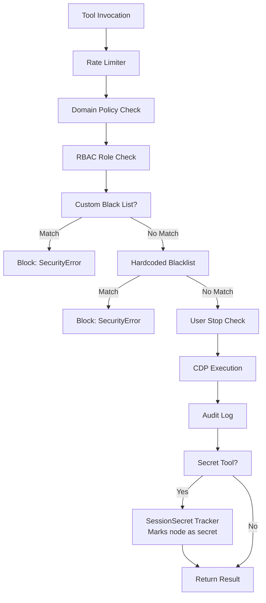

# Weavetab MCP Security Policy

> **Version:** 2.5.1 | **Package:** `@weavetab/mcp` | **Last Updated:** August 2026

---

## Supported Versions

Only the latest major release of Weavetab receives security updates. Users are strongly advised to keep their installation current.

| Version | Supported | Security Updates |
|---------|-----------|------------------|
| 2.x.x | Yes | Yes |
| < 2.0 | No | No |

---

## Architecture Context

Weavetab interacts directly with the local Chromium browser instance via the Chrome DevTools Protocol (CDP). Because it can control the browser at the operating system level, Weavetab operates at a highly privileged layer (Layer 0).

### Security Mechanisms

| Mechanism | Description | Implementation |
|-----------|-------------|----------------|
| **Domain Blacklist** | High-risk domains (banking portals, IAM providers, cloud infrastructure consoles) are hard-blocked from navigation and interaction | Hardcoded entries + user-configurable `block`/`allow` lists in `~/.weavetab/config.json` |
| **Domain Policy Engine** | Per-domain modes: `allow`, `read-only`, `deny`, `audit` | Policies defined as `{ pattern, mode }` entries; read-only mode blocks mutation tools |
| **Localhost Binding & WS Auth** | Both the CDP endpoint and the MCP `--ws` daemon listener are strictly bound to `127.0.0.1` | `--ws` requires a 256-bit shared secret (`~/.weavetab-system/ws-secret`) via `Authorization: Bearer` or JSON-RPC handshake (`crypto.timingSafeEqual`), plus `Host` and `Origin` header validation to block cross-site WebSocket hijacking and DNS rebinding |
| **Zero Cloud Dependency** | Weavetab executes entirely on the local machine | No telemetry, analytics, or user data transmitted unless `telemetry: true` is configured |
| **Rate Limiting** | Configurable actions-per-minute threshold | Mutex-based enforcement prevents runaway agent behavior |
| **Role-Based Access Control** | Five roles restrict tool access | `admin`, `operator`, `viewer`, `automation`, `system` with permission matrices |
| **Root Guard** | Prevents execution as root or superuser at startup | `assertNotRoot()` check on Unix systems |
| **Shadow DOM UI Isolation** | All injected interfaces run in isolated contexts | Prevents host page script tampering |
| **Blind Injection** | Secrets injected via `browser_type_secret` are masked to `[REDACTED]` in all subsequent DOM reads and audit logs | Domain scoping, Shadow DOM isolation, JS property hardening |
| **Secrets Management** | Resolves secrets from project-scoped or global `secrets.json` | `JsonSecretStore` with atomic file writes and `chmod 600` enforcement |
| **Storage Blocker** | Optional nullification of `localStorage`, `sessionStorage`, and `document.cookie` | Prevents tracking and fingerprinting |
| **Input Filter** | Strips elements with suspicious labels from DOM snapshots | Removes excessive length, invisible Unicode characters, prompt injection patterns |
| **Two-Factor Lock Validation** | Browser process lock validated by PID liveness + TCP port connectivity | Prevents stale lock false-positives after crashes |
| **Atomic Config Writes** | Config files written to temp file then renamed atomically | Prevents partial reads from concurrent processes |
| **Path Traversal Protection** | `downloadDir` and `profileDir` paths validated to reject `..` traversal | Prevents directory escape attacks |
| **Proxy Credential Detection** | Proxy URLs with embedded credentials rejected with warning | Users must use environment variables instead |

---

## Blind Injection Threat Model & Hardening

The **Blind Injection** architecture specifically ensures that credentials do not leak back into the LLM context, Weavetab logs, DOM snapshots, visual captures, or scrape results.

### Threats Mitigated

- **Accidental Context Inclusion** — LLM reading the DOM, AX tree, or input discovery and echoing passwords
- **DOM & Scrape Scraping** — Passwords extracted via direct DOM access, `browser_scrape`, or `document.querySelector().value`
- **Visual Capture Leaks** — Passwords visible in screenshots, MHTML snapshots, or PDF printouts
- **Log Scraping** — Passwords appearing in plaintext action logs or audit records
- **DOM Snapshot Leakage** — Secret values masked as `[REDACTED]` in all subsequent maps, deltas, and AX tree dumps
- **Prompt Injection Domain Theft** — Domain check runs before the secret value is ever resolved from disk
- **Coercion & Serialization Leaks** — `JSON.stringify(el)`, `String(el)`, or array spreads leaking underlying element values

### Defense-in-Depth Implementation

1. **Storage at Rest**: Secrets in `~/.weavetab/secrets.json` are encrypted using AES-256-GCM with a machine-isolated key in `~/.weavetab-system/secrets-key`.
2. **In-Process Resolution**: The AI model only receives and passes the key name (`envKey: "MY_KEY"`). The secret value is resolved in memory and injected directly via CDP `Input.insertText`.
3. **DOM Property Hardening**: Injected elements are tagged `data-wt-secret="true"`, instance `.value` getters are overridden with `[REDACTED]`, and `Symbol.iterator`, `Symbol.toPrimitive`, and `toJSON` are locked.
4. **In-Memory SessionSecretTracker**: Tracks node IDs and secret substrings per session to redact any coincidental echoes across ActionMaps, delta diffs, or scrape outputs.
5. **Universal Tool Containment**:
   - `browser_type`: Broad secret regex (`type`, `name`, `id`, `autocomplete`, `aria-label`, PINs, tokens, multi-language variants) auto-hardens target fields and suppresses raw value readbacks.
   - `browser_fill`: Registers secrets in both single and `blast_mode`, redacting return values and scan discovery mode (`scan: true`).
   - `browser_scrape`: Evaluates in-page extraction substituting all attributes of sensitive nodes with `[REDACTED]`.
   - `browser_screenshot`, `browser_snapshot`, `browser_pdf`: Dynamically blanks/masks sensitive fields during capture and restores them in `finally` blocks.

### Threats NOT Mitigated

- This does **not** protect against a compromised host or a malicious OS process with elevated privileges reading the secrets file directly.
- It is not "zero-knowledge"; Weavetab must read and decrypt the secret from `secrets.json` to inject it into Chromium.

### Secrets Resolution Order

When `browser_type_secret({ envKey: 'MY_SECRET' })` is called, the `JsonSecretStore` resolves from:

1. `./.weavetab/secrets.json` (project-scoped, opt-in via `weavetab secrets init --project`)
2. `~/.weavetab/secrets.json` (global default)

The old `EnvSecretProvider` (`.env`-based) is **deprecated and no longer supported**. All secrets must be stored in `secrets.json`. See the [README Secrets Management section](README.md#-secrets-management) for the full CLI workflow.

### Secrets File Format

```json
{
  "ACME_CORP_PASSWORD": {
    "value": "encrypted_aes_gcm_string",
    "domains": ["login.example.com"],
    "createdAt": "2026-08-29T10:00:00.000Z",
    "updatedAt": "2026-08-29T10:00:00.000Z"
  }
}
```

---

## RBAC Role Matrix & Privileged Tool Safeguards

Weavetab defaults to the **`operator`** role. Users who want strict read-only inspection without DOM mutation, clipboard writes, or network interception can switch to the **`viewer`** role in `~/.weavetab/config.json`.

| Tool Category | operator (default) | viewer (least-privilege) | automation | system | admin |
|---------------|--------------------|--------------------------|------------|--------|-------|
| DOM Mutation (`click`, `type`, `fill`, `select`, `pointer`, `upload`) | ✅ | ❌ | ✅ | ❌ | ✅ |
| High-Privilege (`eval`, `cookies`, `storage`, `clipboard`, `network_intercept`, `type_secret`) | ✅ (Audit-logged + Domain Policy guarded) | Read-only subset | ✅ | ❌ | ✅ |
| Read-only (`map`, `find`, `scrape`, `console`, `inspect`, `snapshot`, `screenshot`, `pdf`, `tabs`, `wait`) | ✅ | ✅ | ✅ | ❌ | ✅ |
| System (`thoughts`, `detect`, `performance`, `checkpoint`, `pattern_learn`) | ✅ | ❌ | Non-interactive only | ✅ | ✅ |

### Role Definitions

- **operator (Default)** — Standard agent automation role with full tool access governed by domain blocklists (`*.bank.*`, `paypal.com`), rate limiting, and structured audit logging
- **viewer** — Least-privilege read-only role for auditing and observation without DOM mutation, form submission, or network interception
- **automation** — Non-interactive CI/CD execution role
- **system** — Restricted to telemetry, diagnostics, and checkpointing
- **admin** — Unrestricted administrative access

### High-Privilege Tool Protections (`browser_eval`, `browser_cookies`, `browser_storage`, `browser_clipboard`)

Because Weavetab is a Layer 0 browser and desktop automation engine, tools like `browser_eval`, `browser_cookies`, `browser_storage`, and `browser_clipboard` are core primitives rather than accidental exposures. To protect against indirect prompt injection from untrusted web content:
1. **Pre-Execution Domain Gate**: Every tool call passes through `checkDomain()` before touching CDP. High-risk domains and user-configured `deny` or `read-only` policies block execution immediately.
2. **Structured Audit Trail**: High-privilege invocations (`browser_eval`, `browser_cookies`, `browser_storage`, `browser_network_intercept`, `browser_type_secret`) are recorded via `logActionStructured()` in `~/.weavetab-system/logs/`.
3. **Secret Redaction**: `SessionSecretTracker` strips and masks any blind-injected credentials (`[REDACTED]`) from `browser_eval`, `browser_scrape`, `browser_map`, and snapshot outputs so injected secrets cannot be exfiltrated via script evaluation.

---

## Plugin System Security & 3-Tier Trust Model

The `weavetab plugin add <pkg>` CLI and runtime plugin loader (`src/plugin/loader.ts`, `src/plugin/registry.ts`) enforce a strict 3-tier verification model:

1. **Tier 1 — Official (`@weavetab/*`)**: Cryptographically trusted first-party packages maintained by the Weavetab team.
2. **Tier 2 — Verified Registry**: Community plugins audited and listed in the Weavetab Verified Registry (`registry.json`).
3. **Tier 3 — Unverified Third-Party Packages**:
   - **Mandatory Interactive Confirmation**: Unverified npm packages display a high-visibility security warning detailing code execution, CDP, and filesystem risks, and **block installation** in non-interactive shells unless explicitly overridden by the user.
   - **Manifest & Permission Inspection (`weavetab.json`)**: Before activation, `inspectInstalledPackage()` and `normalizePermissions()` validate the plugin's declared permission manifest (`cdp`, `network`, `fs`, `shell`, `ReadOnly`) and engine compatibility without executing runtime code.

---

## Security Architecture Flow



---

## Reporting a Vulnerability

If you discover a security vulnerability in Weavetab, please **do not** open a public GitHub issue.

Instead, report via one of the following channels:

- **Email**: security@weavetab.dev
- **GitHub**: Use the private vulnerability reporting feature on the repository

### Disclosure Timeline

1. **48 hours** — Acknowledgment of receipt
2. **7 days** — Initial assessment and severity classification
3. **30 days** — Fix deployed (critical) or mitigation plan communicated (moderate)

We strive to provide regular updates on progress throughout the process. If a fix is required, an emergency patch will be published to the NPM registry.

### Severity Classification

| Severity | Definition | Response Time |
|----------|------------|---------------|
| **Critical** | Allows unauthorized system access or credential theft | 48 hours |
| **High** | Allows data exfiltration or privilege escalation | 7 days |
| **Medium** | Limited impact, requires user interaction | 30 days |
| **Low** | Minor security issue with minimal impact | Next release |

---


## Security Best Practices

### For Users

1. **Keep Weavetab Updated** — Always use the latest version to ensure security patches
2. **Use RBAC** — Restrict tool access using appropriate roles (`admin`, `operator`, `viewer`, `automation`, `system`)
3. **Configure Domain Policies** — Block high-risk domains
4. **Use Blind Injection** — Never pass passwords or 2FA codes directly to `browser_type`; use `browser_type_secret`

### For Developers

1. **Test Security Features** — Verify domain policies, RBAC, and rate limiting in tests
2. **Use Least Privilege** - Tools should request only the permissions they need

---

## Security Notifications

To receive security notifications:

- **Watch the GitHub Repository** — Enable releases and security alerts
- **Subscribe to Security Advisories** — Monitor GitHub Security Advisories for the repository
- **Review CHANGELOG.md** — Check security updates in release notes

---

## Contact Information

For security-related inquiries:

- **Security Vulnerabilities**: security@weavetab.dev
- **Security Questions**: conduct@weavetab.dev
- **GitHub Security**: https://github.com/weavetab/mcp/security

---

## License

Weavetab is licensed under AGPL-3.0. Security vulnerabilities should be reported responsibly as outlined in this document. Public disclosure of vulnerabilities before coordination with the maintainers is not permitted.
