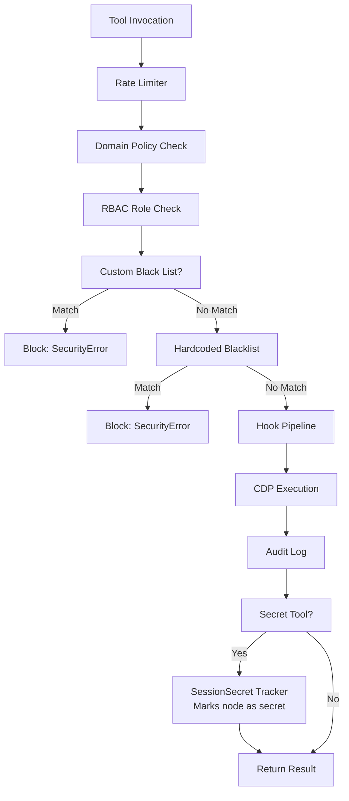

# Weavetab MCP Security Policy

> **Version:** 2.6.4 | **Package:** `@weavetab/mcp` | **Last Updated:** August 2026

---

## Supported Versions

Only the latest major release of Weavetab receives security updates. Users are strongly advised to keep their installation current.

| Version | Supported | Security Updates |
|---------|-----------|------------------|
| 2.x.x | Yes | Yes |
| < 2.0 | No | No |

---

## Architecture Context

Weavetab interacts directly with the local Chromium browser instance via the Chrome DevTools Protocol (CDP). Because it controls the browser and desktop apps locally, Weavetab operates with privileged local access.

### Security Mechanisms

| Mechanism | Description | Implementation |
|-----------|-------------|----------------|
| **Domain Blacklist** | High-risk domains (banking portals, IAM providers, cloud infrastructure consoles) are blocked from navigation and interaction | Default + user-configurable `block`/`allow` lists (`allow` evaluated before `block`) in `~/.weavetab/config.json` with wildcard matching, bare-domain subdomain matching, and trailing-dot normalization |
| **Domain Policy Engine** | Specificity-ordered per-domain modes: `allow`, `read-only`, `deny`, `audit-only` | Policies evaluated by specificity (exact match > longest literal suffix > wildcard); `read-only` blocks mutation tools and enforces action-level read-only checks |
| **Localhost Binding & WS Auth** | Both the CDP endpoint and the MCP `--ws` daemon listener are strictly bound to `127.0.0.1` | `--ws` tracks authentication per-socket with a 5s auth timeout, requires a non-empty 256-bit shared secret (`~/.weavetab-system/ws-secret`, `0o600` + Windows `icacls`), rejects concurrent sockets while active, supports IPv6 `[::1]` Host headers, and validates `Host` and `Origin` |
| **Zero Cloud Dependency** | Weavetab executes entirely on the local machine | Opt-in UDP telemetry gated strictly on `telemetry: true`, atomic `stats.json` writes, and `0o600` + Windows `icacls` on `telemetry-secret`; audit logs in `~/.weavetab-system/logs/` auto-prune to the latest 30 `mission_*` files |
| **Rate Limiting** | Configurable actions-per-minute threshold | Sliding-window enforcement across top-level tools and `browser_burst` sub-steps (`retryAfterMs >= 1`) |
| **Role-Based Access Control** | Five fail-closed roles restrict tool and action access | `admin`, `operator`, `viewer`, `automation`, `system`; `viewer` excludes `browser_eval` and enforces action-level read-only checks on `cookies`, `tabs`, `snapshot`, `console`, and `pattern_learn` |
| **Root Guard** | Prevents execution as root or superuser at startup | `assertNotRoot()` check on Unix systems |
| **Extension & Shadow DOM Isolation** | Injected interfaces run in isolated contexts | Top-frame-only MV3 HUD/cursor mounting, origin-checked messaging, `{ devMode }`-only webpage config injection, and removal of webpage-callable privileged relays |
| **Blind Injection** | Secrets injected via `browser_type_secret` are masked to `[REDACTED]` across DOM reads, delta diffs, session trails, compiled patterns, and audit logs | Domain scoping (trailing-dot normalized, empty-hostname URLs blocked), DOM property hardening, non-destructive CSS capture masking (`-webkit-text-security: disc` / `color: transparent`), and `SessionSecretTracker` |
| **Secrets Management** | Fail-closed AES-256-GCM encryption at rest | `JsonSecretStore` with atomic writes, `0o600` + Windows `icacls` on `secrets.json` and `secrets-key`, and opt-in `WT_PROJECT_SECRETS=1` for project-scoped `./.weavetab/secrets.json` |
| **Storage Blocker** | Optional nullification of `localStorage`, `sessionStorage`, and `Document.prototype` `cookie` descriptor | Prevents tracking and fingerprinting |
| **Input Filter** | Strips elements with suspicious labels from DOM snapshots | Pre-NFKC stripping of invisible chars, bidi overrides (`U+202A–U+202E`, `U+2066–U+2069`), and Unicode Tags (`U+E0000–U+E007F`) while preserving `U+FE0F` and `U+00A0` |
| **Two-Factor Lock & Re-entrant Mutex** | Browser process lock validated by PID liveness + TCP port connectivity | `AsyncLocalStorage` re-entrant CDP mutex, atomic `.tmp` + `renameSync` lockfiles, and `clearLock` preserving active mutexes |
| **Atomic Writes & Path Containment** | Config, lock, telemetry, memory, and plugin storage written atomically | `realpathSync` containment on plugin entries/storage and browser profiles, dangerous browser flag stripping (`--user-data-dir`, `--remote-debugging-*`, `--disable-web-security`), and Electron `XDG_CONFIG_HOME`/`XDG_DATA_HOME` isolation |
| **Proxy Credential Detection** | Proxy URLs with literal credentials rejected before `WT_PROXY_URL` fallback | Prevents credential leakage in process arguments |

---

## Blind Injection Threat Model & Hardening

The **Blind Injection** architecture specifically ensures that credentials do not leak back into the LLM context, Weavetab logs, DOM snapshots, visual captures, or scrape results.

### Threats Mitigated

- **Accidental Context Inclusion** — LLM reading the DOM, AX tree, or input discovery and echoing passwords
- **DOM & Scrape Scraping** — Passwords extracted via direct DOM access, `browser_scrape`, or `document.querySelector().value`
- **Visual Capture Leaks** — Passwords visible in screenshots, MHTML snapshots, or PDF printouts
- **Log Scraping** — Passwords appearing in plaintext action logs or audit records
- **DOM Snapshot Leakage** — Secret values masked as `[REDACTED]` in all subsequent maps, deltas, and AX tree dumps
- **Prompt Injection Domain Theft** — Domain check runs before the secret value is ever resolved from disk
- **Coercion & Serialization Leaks** — `JSON.stringify(el)`, `String(el)`, or array spreads leaking underlying element values

### Defense-in-Depth Implementation

1. **Storage at Rest**: Secrets in `~/.weavetab/secrets.json` are encrypted using fail-closed AES-256-GCM with a machine-isolated key in `~/.weavetab-system/secrets-key` (both protected with `0o600` permissions and Windows `icacls` owner-only ACLs).
2. **In-Process Resolution**: The AI model only receives and passes the key name (`envKey: "MY_KEY"`). The secret value is resolved in memory and injected directly via CDP `Input.insertText`.
3. **DOM Property Hardening**: Injected elements are tagged `data-wt-secret="true"`, instance `.value` getters are overridden with `[REDACTED]`, and `Symbol.iterator`, `Symbol.toPrimitive`, and `toJSON` are locked.
4. **In-Memory SessionSecretTracker**: Tracks node IDs and secret substrings per session (with a `WeakSet` cycle guard) to redact any coincidental echoes across ActionMaps, delta diffs, session trails, compiled patterns, audit logs, or scrape outputs.
5. **Universal Tool Containment**:
   - `browser_type`: Broad secret regex (`type`, `name`, `id`, `autocomplete`, `aria-label`, PINs, tokens, multi-language variants) auto-hardens target fields and suppresses raw value readbacks.
   - `browser_fill`: Registers secrets in both single and `blast_mode`, redacting return values and scan discovery mode (`scan: true`).
   - `browser_scrape`: Evaluates in-page extraction substituting all attributes of sensitive nodes with `[REDACTED]`.
   - `browser_screenshot`, `browser_snapshot`, `browser_pdf`: Applies non-destructive inline CSS capture masking (`-webkit-text-security: disc !important; color: transparent !important; text-shadow: none !important;`) during capture and restores original styles in `finally` blocks without clearing live input values.

### Threats NOT Mitigated

- This does **not** protect against a compromised host or a malicious OS process with elevated privileges reading the secrets file directly.
- It is not "zero-knowledge"; Weavetab must read and decrypt the secret from `secrets.json` to inject it into Chromium.

### Secrets Resolution Order

When `browser_type_secret({ envKey: 'MY_SECRET' })` is called, the `JsonSecretStore` resolves from:

1. `./.weavetab/secrets.json` (project-scoped, loaded only when `WT_PROJECT_SECRETS=1` is set or `cwd === os.homedir()`, initialized via `weavetab secrets init --project`)
2. `~/.weavetab/secrets.json` (global default)

The legacy `.env`-based secret provider has been removed. All secrets must be stored in `secrets.json`.

### Secrets File Format

```json
{
  "ACME_CORP_PASSWORD": {
    "value": "encrypted_aes_gcm_string",
    "domains": ["login.example.com"],
    "createdAt": "2026-08-29T10:00:00.000Z",
    "updatedAt": "2026-08-29T10:00:00.000Z"
  }
}
```

---

## RBAC Role Matrix & Privileged Tool Safeguards

Weavetab defaults to the **`operator`** role and fails closed on unknown roles. Users who want strict read-only inspection without DOM mutation, script evaluation, clipboard writes, or network interception can switch to the **`viewer`** role in `~/.weavetab/config.json`.

| Tool Category | operator (default) | viewer (least-privilege) | automation | system | admin |
|---------------|--------------------|--------------------------|------------|--------|-------|
| DOM Mutation (`click`, `type`, `fill`, `select`, `pointer`, `upload`) | ✅ | ❌ | ✅ | ❌ | ✅ |
| High-Privilege (`eval`, `storage`, `clipboard`, `network_intercept`, `type_secret`) | ✅ (Audit-logged + Domain Policy guarded) | ❌ (`cookies` restricted to same-origin `get`/`list`) | ✅ | ❌ | ✅ |
| Read-only (`map`, `find`, `scrape`, `console` [read], `inspect`, `snapshot` [capture in `snapshotDir`], `screenshot`, `pdf`, `tabs` [list/list_windows], `wait`, `pattern_learn` [get], `detect`) | ✅ | ✅ | ✅ | Subset (`detect`, `pattern_learn`) | ✅ |
| System (`thoughts`, `detect`, `performance`, `checkpoint`, `pattern_learn`) | ✅ | `detect`, `pattern_learn` [get] | Non-interactive (`thoughts` blocked) | ✅ | ✅ |

### Role Definitions

- **operator (Default)** — Standard agent automation role with full tool access governed by domain blocklists (`*.bank.*`, `paypal.com`), rate limiting, and structured audit logging
- **viewer** — Least-privilege read-only role for auditing and observation. Excludes `browser_eval` and enforces action-level read-only gating on `browser_cookies` (`get`/`list` on same origin), `browser_tabs` (`list`/`list_windows`), `browser_snapshot` (`capture` confined to `snapshotDir`), `browser_console` (`read`), and `browser_pattern_learn` (`get`).
- **automation** — Non-interactive CI/CD execution role (`browser_thoughts` blocked)
- **system** — Restricted to telemetry, diagnostics, and checkpointing
- **admin** — Unrestricted administrative access

### High-Privilege Tool Protections (`browser_eval`, `browser_cookies`, `browser_storage`, `browser_clipboard`)

Because Weavetab is a direct browser and desktop automation engine, tools like `browser_eval`, `browser_cookies`, `browser_storage`, and `browser_clipboard` are core primitives rather than accidental exposures. To protect against indirect prompt injection from untrusted web content:
1. **Pre-Execution Domain & Action Gate**: Every tool call (including `browser_detect`, `browser_pattern_learn`, `browser_thoughts`, `browser_dialog`, `page_context` prompt, `WeavetabOpen`, and every sub-step of `browser_burst`) passes through `checkDomain()` and RBAC before touching CDP. High-risk domains and user-configured `deny` or `read-only` policies block execution immediately.
2. **Structured Audit Trail**: High-privilege invocations (`browser_eval`, `browser_cookies`, `browser_storage`, `browser_network_intercept`, `browser_type_secret`) are recorded via `logActionStructured()` in `~/.weavetab-system/logs/` with automatic retention pruning (latest 30 `mission_*` files).
3. **Secret Redaction**: `SessionSecretTracker` strips and masks any blind-injected credentials (`[REDACTED]`) from `browser_eval`, `browser_scrape`, `browser_map`, delta diffs, session trails, compiled patterns, and snapshot outputs so injected secrets cannot be exfiltrated via script evaluation.

---

## Plugin System Security & 3-Tier Trust Model

The `weavetab plugin add <pkg>` CLI and runtime plugin loader (`src/plugin/loader.ts`, `src/plugin/registry.ts`, `src/plugin/storage.ts`) enforce a strict 3-tier verification and containment model:

1. **Tier 1 — Official (`@weavetab/*`)**: First-party packages listed in `OFFICIAL_PACKAGES` and installed with provenance verification (`--ignore-scripts` during install). Official plugins still run through the full `withSecurity()` RBAC and domain policy pipeline.
2. **Tier 2 — Verified Registry**: Community plugins audited and listed in the Weavetab Verified Registry (`registry.json`).
3. **Tier 3 — Unverified Third-Party Packages**:
   - **Mandatory Interactive Confirmation**: Unverified npm packages display a high-visibility security warning detailing code execution, CDP, and filesystem risks, and **block installation** in non-interactive shells unless explicitly overridden by the user.
   - **Manifest-Only Permissions & Path Containment (`weavetab.json`)**: Permissions are read strictly from `weavetab.json` (runtime JS exports cannot self-escalate permissions), `manifest.entry` and plugin storage paths are verified via `fs.realpathSync` containment, and workspace `./plugins` discovery requires explicit `WT_ALLOW_WORKSPACE_PLUGINS=1`.

---

## Security Architecture Flow



---

## Reporting a Vulnerability

If you discover a security vulnerability in Weavetab, please **do not** open a public GitHub issue.

Instead, report via one of the following channels:

- **Email**: security@weavetab.dev
- **GitHub**: Use the private vulnerability reporting feature on the repository

### Disclosure Timeline

1. **48 hours** — Acknowledgment of receipt
2. **7 days** — Initial assessment and severity classification
3. **30 days** — Fix deployed (critical) or mitigation plan communicated (moderate)

We strive to provide regular updates on progress throughout the process. If a fix is required, an emergency patch will be published to the NPM registry.

### Severity Classification

| Severity | Definition | Response Time |
|----------|------------|---------------|
| **Critical** | Allows unauthorized system access or credential theft | 48 hours |
| **High** | Allows data exfiltration or privilege escalation | 7 days |
| **Medium** | Limited impact, requires user interaction | 30 days |
| **Low** | Minor security issue with minimal impact | Next release |

---


## Security Best Practices

### For Users

1. **Keep Weavetab Updated** — Always use the latest version to ensure security patches
2. **Use RBAC** — Restrict tool access using appropriate roles (`admin`, `operator`, `viewer`, `automation`, `system`)
3. **Configure Domain Policies** — Block high-risk domains
4. **Use Blind Injection** — Never pass passwords or 2FA codes directly to `browser_type`; use `browser_type_secret`

### For Developers

1. **Test Security Features** — Verify domain policies, RBAC, and rate limiting in tests
2. **Use Least Privilege** - Tools should request only the permissions they need

---

## Security Notifications

To receive security notifications:

- **Watch the GitHub Repository** — Enable releases and security alerts
- **Subscribe to Security Advisories** — Monitor GitHub Security Advisories for the repository
- **Review CHANGELOG.md** — Check security updates in release notes

---

## Contact Information

For security-related inquiries:

- **Security Vulnerabilities**: security@weavetab.dev
- **Security Questions**: conduct@weavetab.dev
- **GitHub Security**: https://github.com/weavetab/mcp/security

---

## License

Weavetab is licensed under AGPL-3.0. Security vulnerabilities should be reported responsibly as outlined in this document. Public disclosure of vulnerabilities before coordination with the maintainers is not permitted.
