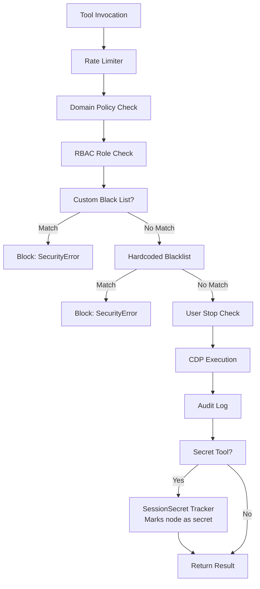

# Weavetab MCP Security Policy

> **Version:** 2.5.0 (Beta) | **Package:** `@weavetab/mcp` | **Last Updated:** August 2026

---

## Supported Versions

Only the latest major release of Weavetab receives security updates. Users are strongly advised to keep their installation current.

| Version | Supported | Security Updates |
|---------|-----------|------------------|
| 2.x.x | Yes | Yes |
| < 2.0 | No | No |

---

## Architecture Context

Weavetab interacts directly with the local Chromium browser instance via the Chrome DevTools Protocol (CDP). Because it can control the browser at the operating system level, Weavetab operates at a highly privileged layer (Layer 0).

### Security Mechanisms

| Mechanism | Description | Implementation |
|-----------|-------------|----------------|
| **Domain Blacklist** | High-risk domains (banking portals, IAM providers, cloud infrastructure consoles) are hard-blocked from navigation and interaction | Hardcoded entries + user-configurable `block`/`allow` lists in `~/.Weavetab/policy.json` |
| **Domain Policy Engine** | Per-domain modes: `allow`, `read-only`, `deny`, `audit` | Policies defined as `{ pattern, mode }` entries; read-only mode blocks mutation tools |
| **Localhost Binding** | The CDP WebSocket endpoint is strictly bound to `127.0.0.1` | No external network interfaces are exposed |
| **Zero Cloud Dependency** | Weavetab executes entirely on the local machine | No telemetry, analytics, or user data transmitted unless `telemetry: true` is configured |
| **Rate Limiting** | Configurable actions-per-minute threshold | Mutex-based enforcement prevents runaway agent behavior |
| **Role-Based Access Control** | Four roles restrict tool access | `admin`, `operator`, `viewer`, `automation` with permission matrices |
| **Root Guard** | Prevents execution as root or superuser at startup | `assertNotRoot()` check on Unix systems |
| **Shadow DOM UI Isolation** | All injected interfaces run in isolated contexts | Prevents host page script tampering |
| **Blind Injection** | Secrets injected via `browser_type_secret` are masked to `[REDACTED]` in all subsequent DOM reads and audit logs | Domain scoping, Shadow DOM isolation, JS property hardening |
| **Secrets Management** | Resolves secrets from project-scoped or global `secrets.json` | `JsonSecretStore` with atomic file writes and `chmod 600` enforcement |
| **Storage Blocker** | Optional nullification of `localStorage`, `sessionStorage`, and `document.cookie` | Prevents tracking and fingerprinting |
| **Input Filter** | Strips elements with suspicious labels from DOM snapshots | Removes excessive length, invisible Unicode characters, prompt injection patterns |
| **Two-Factor Lock Validation** | Browser process lock validated by PID liveness + TCP port connectivity | Prevents stale lock false-positives after crashes |
| **Atomic Config Writes** | Config files written to temp file then renamed atomically | Prevents partial reads from concurrent processes |
| **Path Traversal Protection** | `downloadDir` and `profileDir` paths validated to reject `..` traversal | Prevents directory escape attacks |
| **Proxy Credential Detection** | Proxy URLs with embedded credentials rejected with warning | Users must use environment variables instead |

---

## Blind Injection Threat Model

The **Blind Injection** architecture specifically ensures that credentials do not leak back into the LLM context or Weavetab logs.

### Threats Mitigated

- **Accidental context inclusion** — LLM reading the DOM and echoing passwords
- **Log scraping** — Passwords appearing in plaintext audit logs
- **DOM snapshot leakage** — Secret values masked as `[REDACTED]` in all subsequent maps, deltas, and AX tree dumps
- **Prompt injection domain theft** — Domain check runs before the secret value is ever resolved

### Threats NOT Mitigated

- This does **not** protect against a compromised host or a malicious process reading the secrets file directly
- It is not "zero-knowledge"; Weavetab must read the secret from `secrets.json` to inject it

### Secrets Resolution Order

When `browser_type_secret({ envKey: 'MY_SECRET' })` is called, the `JsonSecretStore` resolves from:

1. `./.Weavetab/secrets.json` (project-scoped, opt-in via `Weavetab secrets init --project`)
2. `~/.Weavetab/secrets.json` (global default)

The old `EnvSecretProvider` (`.env`-based) is **deprecated and no longer supported**. All secrets must be stored in `secrets.json`. See the [README Secrets Management section](README.md#-secrets-management) for the full CLI workflow.

### Secrets File Format

```json
{
  "ACME_CORP_PASSWORD": {
    "value": "hunter2",
    "domains": ["login.example.com"],
    "description": "Account password"
  },
  "GITHUB_2FA": {
    "value": "123456",
    "domains": ["github.com"],
    "description": "2FA Code"
  }
}
```

---

## RBAC Role Matrix

| Tool Category | admin | viewer | system |
|---------------|-------|--------|--------|
| All mutation tools | ✅ | ❌ | ❌ |
| Read-only (map, find, scrape, console, eval, inspect, snapshot, screenshot, pdf, cookies, tabs, wait, github_*) | ✅ | ✅ | ❌ |
| burst, plan, wait, map | ✅ | ❌ | ✅ |
| System (logs, detect, performance, reset_loop_counter) | ✅ | ❌ | ❌ |

### Role Definitions

- **admin** — Full access to all tools and system operations
- **viewer** — Read-only access to observation tools only
- **system** — Restricted to burst/plan/wait/map for automated workflows

---

## Security Architecture Flow



---

## Reporting a Vulnerability

If you discover a security vulnerability in Weavetab, please **do not** open a public GitHub issue.

Instead, report via one of the following channels:

- **Email**: security@weavetab.pages.dev
- **GitHub**: Use the private vulnerability reporting feature on the repository

### Disclosure Timeline

1. **48 hours** — Acknowledgment of receipt
2. **7 days** — Initial assessment and severity classification
3. **30 days** — Fix deployed (critical) or mitigation plan communicated (moderate)

We strive to provide regular updates on progress throughout the process. If a fix is required, an emergency patch will be published to the NPM registry.

### Severity Classification

| Severity | Definition | Response Time |
|----------|------------|---------------|
| **Critical** | Allows unauthorized system access or credential theft | 48 hours |
| **High** | Allows data exfiltration or privilege escalation | 7 days |
| **Medium** | Limited impact, requires user interaction | 30 days |
| **Low** | Minor security issue with minimal impact | Next release |

---


## Security Best Practices

### For Users

1. **Keep Weavetab Updated** — Always use the latest version to ensure security patches
2. **Use RBAC** — Restrict tool access using appropriate roles (`admin`, `viewer`, `system`)
3. **Configure Domain Policies** — Block high-risk domains
4. **Use Blind Injection** — Never pass passwords or 2FA codes directly to `browser_type`; use `browser_type_secret`

### For Developers

1. **Test Security Features** — Verify domain policies, RBAC, and rate limiting in tests
2. **Use Least Privilege** - Tools should request only the permissions they need

---

## Security Notifications

To receive security notifications:

- **Watch the GitHub Repository** — Enable releases and security alerts
- **Subscribe to Security Advisories** — Monitor GitHub Security Advisories for the repository
- **Review CHANGELOG.md** — Check security updates in release notes

---

## Contact Information

For security-related inquiries:

- **Security Vulnerabilities**: security@weavetab.pages.dev
- **Security Questions**: conduct@weavetab.pages.dev
- **GitHub Security**: https://github.com/weavetab/mcp/security

---

## License

Weavetab is licensed under AGPL-3.0. Security vulnerabilities should be reported responsibly as outlined in this document. Public disclosure of vulnerabilities before coordination with the maintainers is not permitted.
