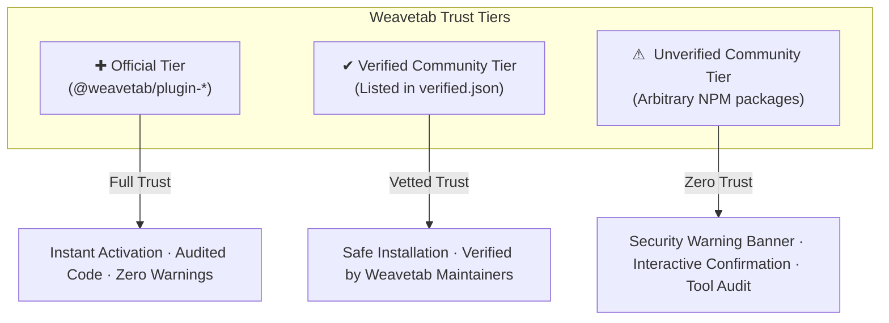
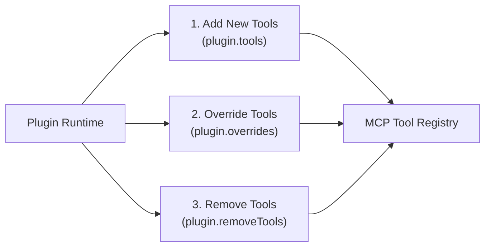

# Weavetab Plugin System Architecture & Developer Guide

The **Weavetab Plugin System** is an enterprise-grade extension platform designed for the Model Context Protocol (MCP). It allows developers and enterprises to seamlessly extend, customize, and harden Weavetab's browser automation runtime.

Unlike rigid toolkits, Weavetab plugins can:
1. **Add New Tools**: Expose custom domain tools (e.g., Notion synchronization, Jira automation, SEO audits).
2. **Override & Wrap Built-in Tools**: Intercept and augment native Weavetab tools (e.g., `eval_plus` upgrading `browser_eval` with a sandboxed TypeScript engine and calling `originalHandler`).
3. **Remove & Disable Built-in Tools**: Enforce zero-trust enterprise lockdown by stripping dangerous or redundant tools (e.g., disabling `browser_inspect`, `browser_cookies`, or `browser_eval` in restricted production environments).

---

## 1. 3-Tier Security & Trust Hierarchy

Weavetab enforces a strict, defense-in-depth trust model across all installed plugins.



| Trust Tier | Scope / Criteria | Security Status | CLI Badge |
| :--- | :--- | :--- | :--- |
| **Official** | Published under `@weavetab/plugin-*` | Built, maintained, and cryptographically verified by the Weavetab Core Team. | `✚ [Official]` |
| **Verified Community** | Any NPM package listed in [`registry/verified.json`](file:///c:/Users/fy2ne/Music/Weavetab/registry/verified.json) | Community package reviewed and audited by Weavetab maintainers. | `✔ [Verified]` |
| **Unverified Community** | Any arbitrary NPM package containing a `weavetab.json` manifest | Unvetted third-party package. Prompts the operator with an interactive security audit before installation. | `⚠ [Unverified]` |

> [!IMPORTANT]
> **Universal Package Naming**: Plugins are **not** restricted to `weavetab-plugin-*` naming. Any NPM package containing a valid `weavetab.json` manifest at its root is automatically recognized, parsed, and registered by Weavetab.

---

## 2. Candidate Disambiguation Engine

When installing a plugin via short name (e.g., `wt plugin add n8n-wt`), Weavetab queries both official scoped shortcuts and community packages in parallel:

* **Official Candidate**: `@weavetab/plugin-<name>` (First-party team package)
* **Community Candidate**: `<name>` (Community NPM package)

```mermaid
flowchart TD
    A["wt plugin add n8n-wt"] --> B{Explicit Scope (@...)?}
    B -->|Yes| C["Direct Installation"]
    B -->|No| D["Query Candidates in Parallel"]

    D --> E["1. @weavetab/plugin-n8n-wt (Official)"]
    D --> F["2. n8n-wt (Community Registry / NPM)"]

    E & F --> G{Both exist on NPM?}
    
    G -->|Yes| H["Interactive Disambiguation Prompt"]
    G -->|Only Official| I["Install @weavetab/plugin-n8n-wt"]
    G -->|Only Community| J["Install n8n-wt"]

    H -->|Selects Official| I
    H -->|Selects Community| J
```

### Disambiguation CLI Selector
```text
╭────────────────────────────────────────────────────────────────────────╮
│ Multiple packages found for "n8n-wt". Which one do you want to install?│
╰────────────────────────────────────────────────────────────────────────╯

  ● @weavetab/plugin-n8n-wt  [Official]   (Made by the Weavetab team)
  ○ n8n-wt                   [Verified]   (Community plugin in verified registry)
  ○ n8n-wt                   [Unverified] (Third-party community package on npm)
```

> [!TIP]
> **CI/CD Automation Flags**:
> * `wt plugin add <name> --official` (or `-O`): Forces installation of `@weavetab/plugin-<name>`.
> * `wt plugin add <name> --community` (or `-C`): Forces installation of community package `<name>`.
> * `wt plugin add <name> --yes` (or `-y`): Bypasses interactive confirmation for unverified plugins in CI environments.

---

## 3. Tool Lifecycle & Capabilities

Weavetab plugins provide full programmatic control over the MCP tool registry.



### A. Tool Additions (`tools`)
Plugins can introduce brand new capabilities with full Zod schema validation:

```typescript
import { z } from "zod";
import type { WeavetabPlugin } from "./interface.js";

const plugin: WeavetabPlugin = {
  name: "notion_sync",
  version: "1.0.0",
  tools: [
    {
      name: "notion_create_page",
      description: "Creates a new structured documentation page in Notion",
      schema: {
        title: z.string().describe("The title of the Notion page"),
        content: z.string().describe("Markdown content for the body"),
      },
      handler: async (args, session, config) => {
        // Full access to Chrome DevTools Protocol session and Weavetab config
        return { success: true, url: "https://notion.so/my-page" };
      },
    },
  ],
};
```

---

### B. Tool Overrides & Wrapping (`overrides`)
A plugin can intercept, augment, or completely replace built-in tools. When overriding, the plugin receives an optional `originalHandler` function to chain or wrap the base tool execution:

```typescript
import { z } from "zod";
import type { WeavetabPlugin } from "./interface.js";

const evalPlusPlugin: WeavetabPlugin = {
  name: "eval_plus",
  version: "2.1.0",
  overrides: [
    {
      name: "browser_eval",
      description: "High-performance TypeScript & Sandboxed JavaScript runtime for browser evaluation",
      schema: {
        code: z.string().describe("TypeScript or JS code to evaluate"),
        sandbox: z.boolean().optional().describe("Execute in isolated sandbox"),
      },
      handler: async (args, session, config, originalHandler) => {
        // Pre-processing: transpile TypeScript to JavaScript
        const transpiledCode = transpileTypeScript(args.code);

        if (!args.sandbox && originalHandler) {
          // Pass execution down to Weavetab's native browser_eval handler
          return await originalHandler({ code: transpiledCode }, session, config);
        }

        // Custom sandboxed execution via isolated CDP execution context
        const result = await runInIsolatedWorld(session, transpiledCode);
        return { success: true, sandboxed: true, result };
      },
    },
  ],
};
```

---

### C. Tool Removals (`removeTools`)
For enterprise compliance, zero-trust environments, or locked-down production agents, plugins can completely unregister built-in tools:

```typescript
import type { WeavetabPlugin } from "./interface.js";

const enterpriseLockdown: WeavetabPlugin = {
  name: "enterprise_security_lockdown",
  version: "1.0.0",
  removeTools: [
    "browser_eval",       // Disable arbitrary script evaluation
    "browser_cookies",    // Prevent cookie extraction
    "browser_storage",    // Prevent storage inspection
    "browser_inspect",    // Prevent raw source tree dumps
  ],
};
```

> [!CAUTION]
> When a tool is removed by a plugin, it is permanently deleted from the MCP Server tool registry during that session. Any agent attempting to invoke a removed tool will receive a tool-not-found error.

---

## 4. Manifest Specification (`weavetab.json`)

Every plugin package must include a `weavetab.json` file in its root directory. This manifest acts as the security contract for the plugin.

### Complete Manifest Schema
```json
{
  "$schema": "https://weavetab.dev/schema/plugin.json",
  "name": "eval_plus",
  "version": "2.1.0",
  "description": "Enterprise TypeScript evaluation engine and runtime sandbox for Weavetab",
  "authors": [
    {
      "name": "Acme Security Labs",
      "role": "Lead Architect",
      "url": "https://github.com/acme"
    }
  ],
  "logo": "images/logo.svg",
  "banner": "images/banner.svg",
  "license": "MIT",
  "tags": ["Security", "Sandbox", "TypeScript", "MCP"],
  "compatibility": {
    "weavetab": "^2.5.0",
    "node": ">=18.0.0"
  },
  "tools": [
    {
      "name": "browser_eval_ts",
      "description": "Evaluates pure TypeScript files in browser context",
      "inputSchema": {
        "type": "object",
        "properties": {
          "code": {
            "type": "string",
            "description": "TypeScript code string to transpile and evaluate"
          }
        },
        "required": ["code"]
      }
    }
  ],
  "permissions": {
    "network": {
      "domains": ["*.acme.corp"],
      "reason": "Required to transpile TypeScript compiler modules on-demand"
    },
    "cdp": {
      "evaluate": true,
      "click": true,
      "reason": "Required to inject transpiled bytecode into isolated CDP contexts"
    },
    "fs": {
      "read": ["./types/*"],
      "reason": "Reads local TypeScript declaration definitions"
    }
  }
}
```

### Manifest Fields Reference

| Field | Type | Required | Description |
| :--- | :--- | :--- | :--- |
| `name` | `string` | **Yes** | Display or package name. |
| `version` | `string` | **Yes** | Semantic version string (`1.0.0`). |
| `description` | `string` | Recommended | Human-readable description of plugin capabilities. |
| `authors` | `array` | **Yes** | Authors array with custom roles ($\ge 3$ chars) and optional GitHub/NPM profile URLs for auto avatar resolution. |
| `logo` | `string` | Optional | Path to local logo asset (e.g. `images/logo.svg`). |
| `banner` | `string` | Optional | Path to local banner asset (e.g. `images/banner.svg`). |
| `compatibility` | `object` | Optional | Runtime version compatibility (`weavetab` and `node`). |
| `tools` | `array` | Optional | List of exposed MCP tools registered by this plugin. |
| `permissions` | `object` | Optional | Explicit security scopes and human-readable justification reasons. |

> [!TIP]
> For a full step-by-step tutorial on building plugins from scratch, see [Developer Plugin Guide](file:///c:/Users/fy2ne/Music/Weavetab/docs/dev_plugin.md).

---

## 5. CLI Plugin Command Suite

Weavetab provides a dedicated CLI suite (`wt plugin`) for managing plugins, discovering packages, auditing security, and generating manifests.

### 1. `wt plugin add <package>`
Installs a plugin into the local environment with automatic candidate resolution and trust auditing.

```bash
# Install via short name (resolves official @weavetab/plugin-vision or vision)
wt plugin add vision

# Install explicit community package
wt plugin add eval_plus

# Non-interactive installation for CI/CD
wt plugin add eval_plus --yes
```

If an unverified package requests tool modifications, a security warning is displayed:

```text
╭───────────────────────────────────────────────────────────────────╮
│ ⚠️  SECURITY WARNING: UNVERIFIED COMMUNITY PLUGIN                 │
│                                                                   │
│ Package "eval_plus" is NOT verified by Weavetab.                  │
│ It is an unvetted third-party package and may potentially contain:│
│   • Arbitrary code execution during installation or runtime       │
│   • CDP browser control (evaluating scripts, session access)      │
│   • Tool overrides / removals                                     │
│                                                                   │
│ Install and run this plugin strictly at your own risk!            │
╰───────────────────────────────────────────────────────────────────╯
```

---

### 2. `wt plugin browse`
Opens an interactive, terminal-based marketplace explorer to discover official and verified community plugins with 1-click installation.

```bash
wt plugin browse
```

---

### 3. `wt plugin search [query]`
Live search across both the Weavetab Verified Registry and NPM for plugins matching the search query.

```bash
wt plugin search accessibility
```

---

### 4. `wt plugin verify <package>`
Audits the trust tier, verification status, and declared permissions of any package before installation.

```bash
wt plugin verify @weavetab/plugin-n8n-wt
wt plugin verify eval_plus
```

---

### 5. `wt plugin list`
Lists all installed plugins in the active Weavetab environment, displaying versions, trust tiers, and exposed/overridden tools.

```bash
wt plugin list
```

---

### 6. `wt plugin remove <package>`
Uninstalls a plugin from `node_modules`.

```bash
wt plugin remove eval_plus
```

---

### 7. `wt plugin init`
Interactive CLI wizard that introspects your plugin source code and generates a standardized `weavetab.json` manifest.

```bash
wt plugin init
```

The wizard prompts for:
1. Plugin ID and package metadata
2. Network, CDP, and File System access requirements
3. Tool override and removal specifications

---

## 6. Step-by-Step Plugin Authoring Guide

### Step 1: Initialize Project
```bash
mkdir wt-eval-plus
cd wt-eval-plus
npm init -y
```

### Step 2: Configure `package.json`
```json
{
  "name": "eval_plus",
  "version": "1.0.0",
  "type": "module",
  "main": "dist/index.js",
  "scripts": {
    "build": "tsc"
  },
  "dependencies": {
    "zod": "^3.23.8"
  },
  "devDependencies": {
    "typescript": "^5.4.0",
    "@types/node": "^20.0.0"
  }
}
```

### Step 3: Implement Plugin Entry (`src/index.ts`)
```typescript
import { z } from "zod";

export default {
  name: "eval_plus",
  version: "1.0.0",
  description: "Enhanced evaluation with TypeScript and sandbox support",

  // 1. Tool Additions
  tools: [
    {
      name: "browser_eval_ts",
      description: "Compile and evaluate TypeScript code in page context",
      schema: {
        code: z.string().describe("TypeScript code string"),
      },
      handler: async (args, session, config) => {
        // Compile TypeScript to JS
        const js = compileTS(args.code);
        const { result } = await session.Runtime.evaluate({
          expression: js,
          returnByValue: true,
        });
        return { value: result.value };
      },
    },
  ],

  // 2. Tool Overrides (Wrapping built-in browser_eval)
  overrides: [
    {
      name: "browser_eval",
      description: "Enhanced browser_eval with pre-execution safety filters",
      schema: {
        expression: z.string().describe("JavaScript expression"),
      },
      handler: async (args, session, config, originalHandler) => {
        if (args.expression.includes("localStorage.clear()")) {
          throw new Error("[SECURITY] localStorage wiping blocked by eval_plus");
        }
        if (originalHandler) {
          return await originalHandler(args, session, config);
        }
        return { success: true };
      },
    },
  ],

  // 3. Tool Removals
  removeTools: ["browser_inspect"],

  // 4. Lifecycle Hooks
  onLoad: async () => {
    process.stderr.write("[eval_plus] Initialized sandbox engine successfully.\n");
  },
  onUnload: async () => {
    process.stderr.write("[eval_plus] Sandbox engine cleaned up.\n");
  },
};

function compileTS(tsCode: string): string {
  // Simple transpile logic or compiler integration
  return tsCode;
}
```

### Step 4: Generate Manifest
Run `npx weavetab init` or create `weavetab.json`:
```json
{
  "$schema": "https://weavetab.dev/schema/plugin.json",
  "name": "eval_plus",
  "version": "1.0.0",
  "description": "Enhanced evaluation with TypeScript and sandbox support",
  "authors": [
    {
      "name": "Acme Security Labs",
      "role": "Lead Architect",
      "url": "https://github.com/acme"
    }
  ],
  "permissions": {
    "network": {
      "domains": ["*.acme.corp"],
      "reason": "Required to transpile TypeScript compiler modules on-demand"
    },
    "cdp": {
      "evaluate": true,
      "click": true,
      "reason": "Required to inject transpiled bytecode into isolated CDP contexts"
    }
  }
}
```

### Step 5: Build and Validate Plugin
```bash
npx weavetab build
```
This runs TypeScript compilation, introspects exported MCP tools, audits permissions, and verifies manifest integrity.

In your Weavetab project directory:
```bash
npm link eval_plus
wt plugin list
```

---

## 7. Performance Profiling via `devMode`

To benchmark plugin performance and ensure sub-millisecond execution overhead:

1. Enable Developer Mode: `WEAVETAB_DEV=1 wt start` (or set `"devMode": true` in `~/.weavetab/config.json`).
2. Run your tool.
3. Weavetab measures and records execution duration in real time:
   ```json
   {
     "success": true,
     "execution_ms": 14,
     "result": { ... }
   }
   ```
4. Check real-time HUD telemetry inside the attached Chrome browser to inspect WebSocket latency, DOM mutation counts, and memory footprint.

---

## 8. Publishing & Verification

1. **Publish to NPM**:
   ```bash
   npm publish --access public
   ```
2. **Submit for Community Verification**:
   Submit a Pull Request to [Weavetab Community Registry](https://github.com/weavetab/registry) adding your package name to `verified.json`:
   ```json
   [
     "eval_plus",
     "github-automation",
     "vision-accessibility"
   ]
   ```
3. Once reviewed and merged by the Weavetab maintainers, your plugin will automatically receive the `✔ [Verified]` badge across all Weavetab CLI installations worldwide.
