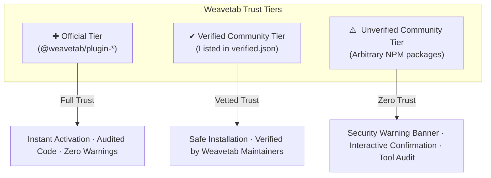

# ⚠️ Weavetab Plugin System (v2.5.0-beta.1) ⚠️

> [!NOTE]
> **OFFICIAL PLUGIN ARCHITECTURE**
>
> The Weavetab Plugin System and SDK are designed for modular, decoupled extension of the Weavetab MCP runtime.
> - **SDK Package:** [`@weavetab/sdk`](https://www.npmjs.com/package/@weavetab/sdk) (`v2.5.0-beta.1`)
> - **Core MCP Server:** [`@weavetab/mcp`](https://www.npmjs.com/package/@weavetab/mcp) (`v2.5.0-beta.1`)
> - **Ecosystem Hub:** [https://weavetab.pages.dev](https://weavetab.pages.dev)

---

# Weavetab Plugin System Architecture & Developer Guide

The **Weavetab Plugin System** is an enterprise-grade extension platform designed for the Model Context Protocol (MCP). It allows developers and enterprises to seamlessly extend, customize, and harden Weavetab's browser automation runtime.

Unlike rigid toolkits, Weavetab plugins can:
1. **Add New Tools**: Expose custom domain tools (e.g., Notion synchronization, Jira automation, SEO audits, YouTube auto-liker).
2. **Isolated Configurations**: Maintain per-plugin settings in `~/.weavetab/plugins/<name>/config.json` without modifying global config.
3. **Sandboxed Persistent Storage**: Store key-value data and JSON files inside `~/.weavetab/plugins/<name>/`.
4. **Extension & HUD Visuals**: Display real-time animated thought bubbles, HUD badges, and inject CSS styles directly into live tabs.
5. **Tool Overrides & Wrapping**: Wrap built-in tools (like `browser_eval` or `browser_click`) with custom security policies or telemetry.
6. **Execution Lifecycle Hooks**: Intercept all tool actions before/after execution with `beforeToolCall` and `afterToolCall`.

---

## 1. Isolated Plugin Storage & Sandbox Architecture

```text
~/.weavetab/
├── config.json                             <-- Core Weavetab settings
├── secrets.json                            <-- Blind-injected credentials
└── plugins/
    ├── weavetab-plugin-youtube-autolike/
    │   ├── config.json                     <-- Plugin configuration (auto-created from defaults)
    │   ├── storage.json                    <-- Sandboxed key-value data
    │   └── data/                           <-- Arbitrary plugin assets / caches
    └── custom-scraper/
        ├── config.json
        └── storage.json
```

### Key Sandbox Guarantees:
- **Zero Pollution**: Core `~/.weavetab/config.json` is protected and isolated from plugin changes.
- **Auto-Initialization**: Default configs specified in `weavetab.json` or `definePlugin()` are automatically written on first load.
- **Path-Traversal Prevention**: `ctx.storage.getPath()` strictly rejects directory breakout attempts (`../`).

---

## 2. 3-Tier Security & Trust Hierarchy

Weavetab enforces a strict, defense-in-depth trust model across all installed plugins:



| Trust Tier | Scope / Criteria | Security Status | CLI Badge |
| :--- | :--- | :--- | :--- |
| **Official** | Published under `@weavetab/plugin-*` | Built, maintained, and cryptographically verified by the Weavetab Core Team. | `✚ [Official]` |
| **Verified Community** | Any NPM package listed in `verified.json` | Community package reviewed and audited by Weavetab maintainers. | `✔ [Verified]` |
| **Unverified Community** | Any arbitrary NPM package containing a `weavetab.json` manifest | Unvetted third-party package. Prompts the operator with an interactive security audit before installation. | `⚠ [Unverified]` |

---

## 3. Tool Registration & Lifecycle

Weavetab plugins export a plugin definition using the `definePlugin` helper from `@weavetab/sdk`:

```typescript
import { definePlugin, type PluginContext } from "@weavetab/sdk";

export default definePlugin({
  name: "weavetab-plugin-notion",

  defaultConfig: {
    workspaceId: "default",
    showThought: true,
  },

  async onLoad(ctx: PluginContext) {
    ctx.mcp.registerTool({
      name: "notion_create_page",
      description: "Creates a new structured documentation page in Notion",
      schema: {
        type: "object",
        properties: {
          title: { type: "string", description: "The title of the Notion page" },
          content: { type: "string", description: "Markdown content for the body" },
        },
        required: ["title", "content"],
      },
      handler: async (args: { title: string; content: string }, session: any) => {
        // Show visual feedback on page
        if (ctx.config.showThought && session) {
          await ctx.extension.showThought(session, `Creating Notion page: ${args.title}`);
        }

        return {
          content: [
            {
              type: "text",
              text: `Page "${args.title}" created successfully.`,
            },
          ],
        };
      },
    });
  },

  async onUnload(ctx: PluginContext) {
    console.log("Notion plugin unloaded.");
  },
});
```

---

## 4. Manifest Specification (`weavetab.json`)

Every plugin package must include a `weavetab.json` file in its root directory:

```json
{
  "$schema": "https://weavetab.pages.dev/schema/plugin.json",
  "name": "weavetab-plugin-example",
  "version": "1.0.0",
  "description": "Example custom tools for Weavetab",
  "entry": "dist/index.js",
  "engines": {
    "weavetab": "^2.5.0",
    "node": ">=18.0.0"
  },
  "environments": ["mcp"],
  "defaultConfig": {
    "enabled": true,
    "showVisualHud": true
  },
  "permissions": {
    "config": {
      "read": true,
      "write": true,
      "reason": "Allows isolated config storage in .weavetab/plugins/."
    },
    "extension": {
      "hud": true,
      "styles": true,
      "reason": "Allows visual HUD badges and floating thought bubbles."
    },
    "cdp": {
      "evaluate": true,
      "click": true,
      "reason": "Executes DOM automation scripts in the active tab."
    }
  },
  "tools": [
    {
      "name": "example_tool",
      "description": "Demonstration tool registered by this plugin"
    }
  ]
}
```

---

## 5. CLI Plugin Command Suite

Weavetab provides a dedicated CLI suite (`weavetab plugin`) for managing plugins:

```bash
# Install official or community plugin
weavetab plugin add @weavetab/plugin-youtube
weavetab plugin add custom-scraper

# List installed plugins
weavetab plugin list

# Search registry
weavetab plugin search accessibility

# Remove plugin
weavetab plugin remove custom-scraper
```

---

## 6. Developing with `@weavetab/sdk`

To scaffold, compile, and validate a new plugin:

```bash
# 1. Initialize a new plugin template
npx @weavetab/sdk init my-plugin
cd my-plugin

# 2. Install dependencies
npm install

# 3. Build & validate
npm run build
```
