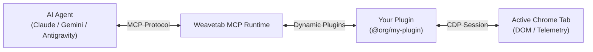

# Weavetab Plugin Developer Guide: Build from Scratch

Welcome to the **Weavetab Plugin Developer Guide**. This comprehensive guide teaches you how to build, test, validate, and publish an enterprise-grade Model Context Protocol (MCP) plugin for the **Weavetab** browser automation runtime.

---

## 1. Architecture Overview

Weavetab plugins extend the capabilities of AI coding assistants (like Antigravity, Claude, Gemini, Cursor) by exposing specialized browser automation tools, DOM inspection scripts, and API connectors.



### Key Plugin Capabilities:
1. **Expose MCP Tools**: Define custom tools with TypeScript parameter schemas.
2. **Execute In-Browser JavaScript**: Evaluate live DOM scripts via Chrome DevTools Protocol (CDP).
3. **Automate User Actions**: Click elements, inspect stylesheets, extract structured data, or interact with web apps.
4. **Zero Configuration**: Zero-friction distribution via standard NPM packages.

---

## 2. Quickstart: 3-Minute Plugin Creation

The fastest way to start is with the interactive Weavetab CLI wizard:

```bash
# 1. Initialize a new plugin directory
mkdir my-tab-plugin && cd my-tab-plugin

# 2. Run the interactive scaffolding wizard
npx weavetab init
```

The CLI wizard will prompt you for:
- **Package Identifier**: e.g., `@myorg/wt-plugin` or `wt-plugin`
- **Display Name**: e.g., `Tab Inspector`
- **Description**: A short summary of your plugin's capabilities
- **Author Handle / URL**: Your name, GitHub handle (e.g. `username`), or NPM profile
- **Author Role**: Any custom title $\ge 3$ characters (e.g. `Creator`, `Maintainer`, `Lead Architect`)
- **Template Architecture**:
  - `CDP Browser Automation`: Evaluates DOM scripts and automates browser actions
  - `External API Connector`: Exposes specialized MCP data tools
  - `Minimal Starter`: Clean, barebones TypeScript scaffold

---

## 3. Project File Tree Breakdown

After running `weavetab init`, your project contains a production-ready structure:

```text
my-tab-plugin/
├── src/
│   └── index.ts          # Plugin logic and MCP tool definitions
├── images/
│   ├── logo.svg          # Plugin logo (displayed in marketplace)
│   └── banner.svg        # Marketplace header banner
├── test/
│   └── plugin.test.js    # Unit test suite
├── package.json          # Standard NPM package manifest
├── tsconfig.json         # Strict TypeScript compiler configuration
├── weavetab.json         # Weavetab MCP security manifest
└── README.md             # Documentation with live tools table
```

---

## 4. Understanding `weavetab.json`

The `weavetab.json` file serves as the plugin's metadata, capability specification, and security contract.

### Example Manifest:
```json
{
  "$schema": "https://weavetab.dev/schema/plugin.json",
  "name": "Tab Inspector",
  "version": "1.0.0",
  "description": "Inspects live DOM telemetry and active tab metadata.",
  "authors": [
    {
      "name": "Alex River",
      "role": "Lead Architect",
      "url": "https://github.com/alexriver"
    }
  ],
  "logo": "images/logo.svg",
  "banner": "images/banner.svg",
  "license": "MIT",
  "tags": ["Automation", "Developer Tools", "MCP", "CDP"],
  "compatibility": {
    "weavetab": "^2.5.0",
    "node": ">=18.0.0"
  },
  "permissions": {
    "network": {
      "domains": ["*"],
      "reason": "Required to inspect web tabs and telemetry."
    },
    "cdp": {
      "evaluate": true,
      "click": true,
      "reason": "Evaluates DOM scripts and queries tab metadata via Chrome DevTools Protocol."
    }
  },
  "tools": [
    {
      "name": "inspect_tab",
      "description": "Inspects live DOM telemetry and active tab properties.",
      "inputSchema": {
        "type": "object",
        "properties": {
          "query": {
            "type": "string",
            "description": "Optional CSS selector or keyword filter."
          }
        }
      }
    }
  ]
}
```

### Manifest Fields Reference:

| Field | Type | Rules & Validation | Description |
| :--- | :--- | :--- | :--- |
| `name` | `string` | Required, non-empty | Human-readable plugin name. |
| `version` | `string` | Required, SemVer format | Semantic version (e.g. `1.0.0`). |
| `description` | `string` | Recommended $\ge 10$ chars | Overview shown on the registry. |
| `authors` | `array` | At least 1 author | List of maintainers and creators. |
| `authors[].name` | `string` | Required ($\ge 2$ chars) | Name or handle. |
| `authors[].role` | `string` | Custom ($\ge 3$ chars) | Any title (e.g. `Creator`, `Maintainer`, `Core Contributor`). |
| `authors[].url` | `string` | Optional (HTTP/HTTPS) | Profile URL (GitHub or NPM handle for auto avatar). |
| `authors[].avatar` | `string` | Optional | Custom image fallback if profile URL is omitted. |
| `compatibility` | `object` | `weavetab` and `node` | Environment runtime semver range. |
| `permissions` | `object` | Requires `reason` | Security declarations explaining access needs. |
| `tools` | `array` | Alphanumeric tool names | List of exposed MCP tools. |

---

## 5. Writing MCP Tools in TypeScript (`src/index.ts`)

Inside `src/index.ts`, define your tools and export the `plugin` object:

```typescript
export interface WeavetabSession {
  evaluate<T = any>(script: string): Promise<T>;
  click?(selector: string): Promise<any>;
  navigate?(url: string): Promise<any>;
}

export interface PluginToolArgs {
  selector?: string;
}

export interface WeavetabPluginTool {
  name: string;
  description: string;
  schema?: Record<string, any>;
  handler: (args: PluginToolArgs, session?: WeavetabSession, config?: any) => Promise<any>;
}

export interface WeavetabPluginDefinition {
  name: string;
  version: string;
  description: string;
  tools: WeavetabPluginTool[];
}

export const plugin: WeavetabPluginDefinition = {
  name: "tab-inspector",
  version: "1.0.0",
  description: "Inspects live DOM telemetry and active tab metadata.",
  tools: [
    {
      name: "inspect_elements",
      description: "Extracts title, URL, and matching DOM elements from the active tab.",
      schema: {
        type: "object",
        properties: {
          selector: {
            type: "string",
            description: "Optional CSS selector to query elements on the page."
          }
        }
      },
      handler: async (args: PluginToolArgs, session?: WeavetabSession) => {
        if (!session || typeof session.evaluate !== "function") {
          return {
            status: "error",
            error: "No active Chrome DevTools Protocol (CDP) session attached."
          };
        }

        try {
          const result = await session.evaluate(`
            (() => {
              const targetSelector = ${JSON.stringify(args?.selector || "body")};
              const elements = Array.from(document.querySelectorAll(targetSelector)).slice(0, 10);
              return {
                title: document.title,
                url: window.location.href,
                matches: elements.map(el => ({
                  tag: el.tagName.toLowerCase(),
                  id: el.id || null,
                  className: el.className || null,
                  text: el.textContent?.trim().substring(0, 100) || ""
                }))
              };
            })()
          `);

          return {
            status: "success",
            data: result
          };
        } catch (err: any) {
          return {
            status: "error",
            error: err.message || String(err)
          };
        }
      }
    }
  ]
};

export default plugin;
```

---

## 6. Building & Syncing: `npx weavetab build`

Whenever you write or modify tool code, run:

```bash
npx weavetab build
```

### What `weavetab build` does:
1. **TypeScript Compilation**: Compiles `src/` to `dist/index.js` using `tsc`.
2. **Dynamic Code Introspection**: Reads your exported tools and extracts names, descriptions, and parameter schemas.
3. **Auto-Manifest Synchronization**: Automatically updates `weavetab.json` with any newly added tools and synced `package.json` versions.
4. **Validation & Security Audit**:
   - Validates that tool names match `^[a-zA-Z0-9_-]+$`.
   - Ensures author roles are at least 3 characters.
   - Validates SemVer version formatting.
   - Checks that referenced logo and banner files exist on disk.
   - Verifies that permission justifications (`reason`) are provided.

### Example Build Output:
```text
✔ Built TypeScript source files to dist/.
✔ Discovered 1 MCP tool(s).

╭────────────────────── WEAVETAB PLUGIN BUILD COMPLETED ──────────────────────╮
│                                                                             │
│  Package:        tab-inspector (v1.0.0)                                     │
│  Entrypoint:     dist/index.js                                              │
│  Permissions:    CDP (Browser Automation), Network (*)                      │
│  Manifest:       weavetab.json (Synced & Validated)                         │
│                                                                             │
│ Exposed MCP Tools:                                                          │
│     • inspect_elements - Extracts title, URL, and matching DOM elements     │
│                                                                             │
│ Ready to publish to NPM:                                                    │
│   npm publish --access public                                               │
╰─────────────────────────────────────────────────────────────────────────────╯
```

---

## 7. Testing Your Plugin

Run the included Node.js test suite to verify your tool exports:

```bash
npm test
```

The test runner ensures your entrypoint loads cleanly, exports valid MCP tool signatures, and contains the required properties.

---

## 8. Publishing & Marketplace Distribution

### 1. Publish to NPM
Weavetab plugins are standard NPM packages:

```bash
npm publish --access public
```

### 2. Immediate Community Availability
Once published to NPM, anyone using Weavetab can install your plugin immediately:

```bash
npx weavetab add <your-package-name>
```

### 3. Submitting for Verification (Optional)
To obtain the **`✔ [Verified]`** badge on the official Weavetab registry:
1. Open a Pull Request to [weavetab/registry](https://github.com/weavetab/registry).
2. Add your package name to `verified.json`.
3. Once merged, your plugin displays the verified badge in both the CLI and online marketplace!
