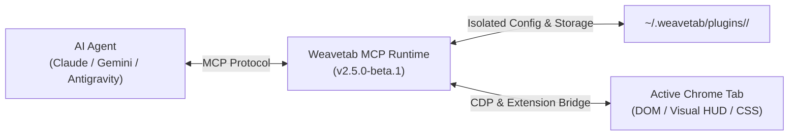

# Weavetab Plugin Developer Guide: Build from Scratch

> [!NOTE]
> **PLUGIN ENGINE (v2.5.0-beta.1)**
>
> All plugins should use the official **`@weavetab/sdk`** package (`v2.5.0-beta.1`) for type definitions, isolated configurations, visual HUD extensions, and CLI validation tools.

Welcome to the **Weavetab Plugin Developer Guide**. This comprehensive guide teaches you how to build, test, validate, and publish an enterprise-grade Model Context Protocol (MCP) plugin for the **Weavetab** browser automation runtime.

---

## 1. Architecture Overview

Weavetab plugins extend AI coding assistants (like Antigravity, Claude, Gemini, Cursor, Copilot) by exposing specialized browser automation tools, isolated configs, DOM inspection scripts, and rich visual HUD feedback.



### Key Plugin Capabilities:
1. **Expose MCP Tools**: Define custom tools with TypeScript parameter schemas.
2. **Isolated Plugin Configuration**: Store settings in `~/.weavetab/plugins/<name>/config.json`.
3. **Sandboxed Key-Value & File Storage**: Store credentials, counters, and JSON files inside `~/.weavetab/plugins/<name>/`.
4. **Visual HUD Feedback**: Show floating thought bubbles (`showThought`), update status badges (`setHudState`), and inject CSS stylesheets (`injectStyles`).
5. **Tool Overrides & Wrapping**: Wrap built-in tools (like `browser_eval` or `browser_click`) with security gates or metrics.
6. **Execution Lifecycle Hooks**: Intercept all tool actions with `beforeToolCall` and `afterToolCall`.

---

## 2. Quickstart: 3-Minute Plugin Creation

The fastest way to start is using `@weavetab/sdk`:

```bash
# Initialize a new plugin template
npx -y @weavetab/sdk init my-custom-plugin
cd my-custom-plugin

# Install dependencies and build
npm install
npm run build
```

---

## 3. Project File Structure

```text
my-custom-plugin/
├── src/
│   └── index.ts          # Plugin logic, tools, hooks, and visuals
├── package.json          # Standard NPM package manifest
├── tsconfig.json         # Strict TypeScript compiler configuration
├── weavetab.json         # Weavetab MCP security & capability manifest
└── README.md             # Documentation
```

---

## 4. Understanding `weavetab.json`

The `weavetab.json` file serves as the plugin's metadata, capability specification, and security contract:

```json
{
  "$schema": "https://weavetab.pages.dev/schema/plugin.json",
  "name": "weavetab-plugin-inspector",
  "version": "1.0.0",
  "description": "Inspects live DOM telemetry and displays visual HUD feedback.",
  "entry": "dist/index.js",
  "engines": {
    "weavetab": "^2.5.0",
    "node": ">=18.0.0"
  },
  "environments": ["mcp"],
  "defaultConfig": {
    "showVisualHud": true,
    "maxDepth": 5
  },
  "permissions": {
    "config": {
      "read": true,
      "write": true,
      "reason": "Allows isolated config storage in .weavetab/plugins/."
    },
    "extension": {
      "hud": true,
      "styles": true,
      "reason": "Displays visual HUD badges and thought bubble feedback."
    },
    "cdp": {
      "evaluate": true,
      "reason": "Evaluates DOM scripts via Chrome DevTools Protocol."
    }
  },
  "tools": [
    {
      "name": "inspect_tab",
      "description": "Inspects live DOM telemetry and active tab properties."
    }
  ]
}
```

---

## 5. Writing MCP Tools with Visuals & Storage (`src/index.ts`)

```typescript
import { definePlugin, type PluginContext } from "@weavetab/sdk";

export default definePlugin({
  name: "weavetab-plugin-inspector",

  defaultConfig: {
    showVisualHud: true,
    maxDepth: 5,
  },

  async onLoad(ctx: PluginContext) {
    ctx.logger.info("Inspector plugin loaded with config:", ctx.config);

    // Register a custom MCP tool
    ctx.mcp.registerTool({
      name: "inspect_tab",
      description: "Extracts title, URL, and matching DOM elements from the active tab.",
      schema: {
        type: "object",
        properties: {
          selector: {
            type: "string",
            description: "Optional CSS selector to query elements on the page.",
          },
        },
      },
      handler: async (args: { selector?: string }, session: any) => {
        // Track invocations in isolated persistent storage
        const runs = (await ctx.storage.get<number>("inspectRuns", 0)) || 0;
        await ctx.storage.set("inspectRuns", runs + 1);

        // Render animated visual thought bubble in the browser
        if (ctx.config.showVisualHud && session) {
          await ctx.extension.showThought(
            session,
            `🔍 Inspecting selector: ${args.selector || "body"}`
          );
          await ctx.extension.setHudState(session, {
            badge: "Inspecting",
            badgeColor: "#3b82f6",
          });
        }

        return {
          content: [
            {
              type: "text",
              text: `Inspected selector: ${args.selector || "body"} (Run #${runs + 1})`,
            },
          ],
        };
      },
    });

    // Lifecycle hooks
    ctx.hooks.beforeToolCall((toolName, toolArgs) => {
      ctx.logger.debug(`[Inspector] Before tool: ${toolName}`, toolArgs);
    });
  },

  async onUnload(ctx: PluginContext) {
    ctx.logger.info("Inspector plugin unloaded.");
  },
});
```

---

## 6. Building & Validating: `weavetab build` & `weavetab validate`

Whenever you write or modify tool code, compile and audit your project:

```bash
# Build TypeScript and synchronize weavetab.json
npm run build

# Or validate manifest directly
npx weavetab validate
```

---

## 7. Publishing & Marketplace Distribution

### 1. Publish to NPM
```bash
npm publish --access public
```

### 2. Installation into Weavetab
```bash
weavetab plugin add <your-package-name>
```

### 3. Submitting for Verification
To receive the **`✔ [Verified]`** badge on the official Weavetab registry:
1. Open a Pull Request to [weavetab/registry](https://github.com/weavetab/registry).
2. Add your package name to `verified.json`.
3. Once merged, your plugin displays the verified badge in both the CLI and online marketplace!
